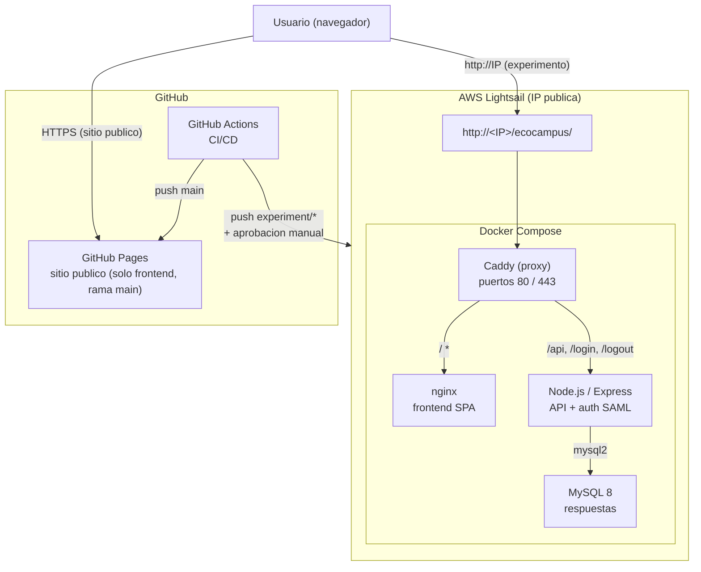
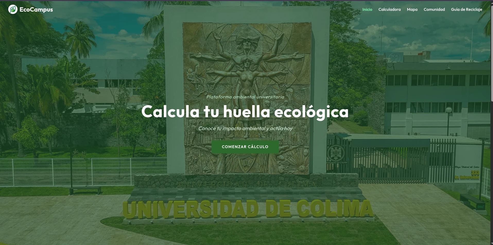
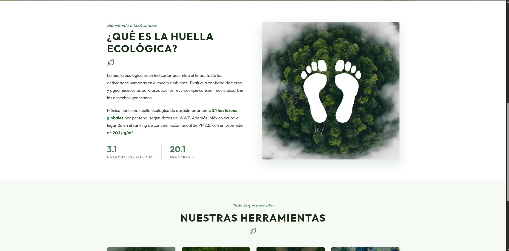
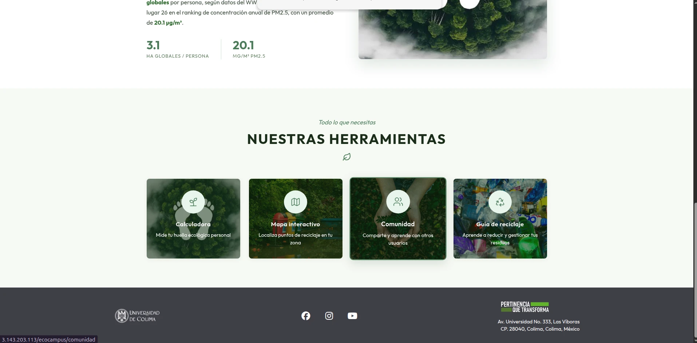
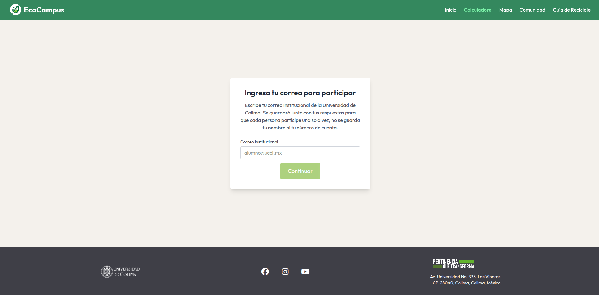
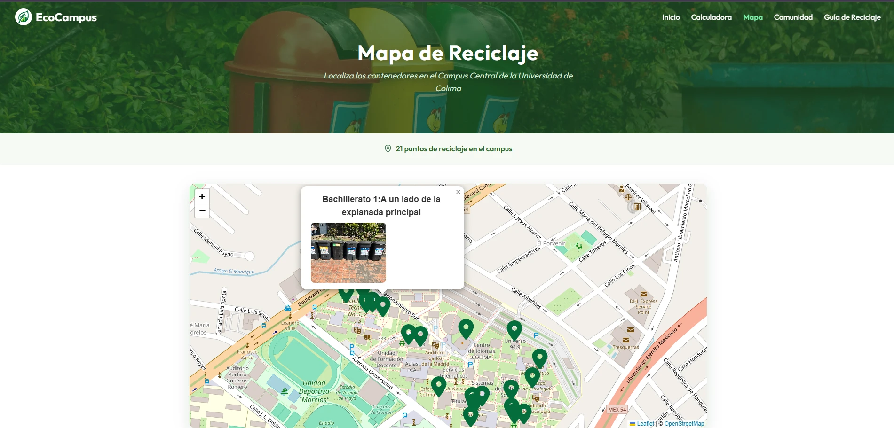
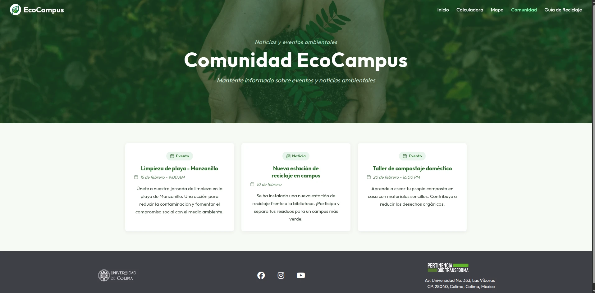
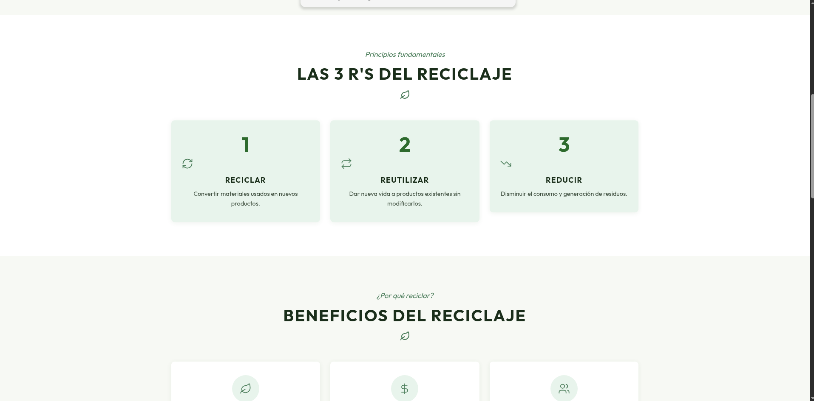
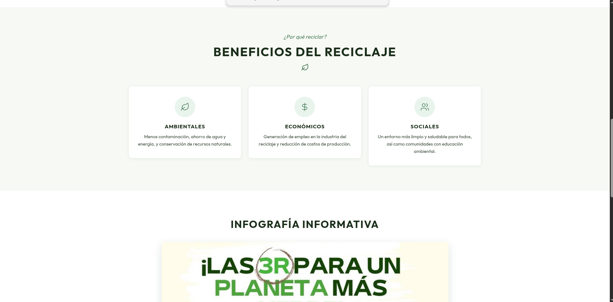
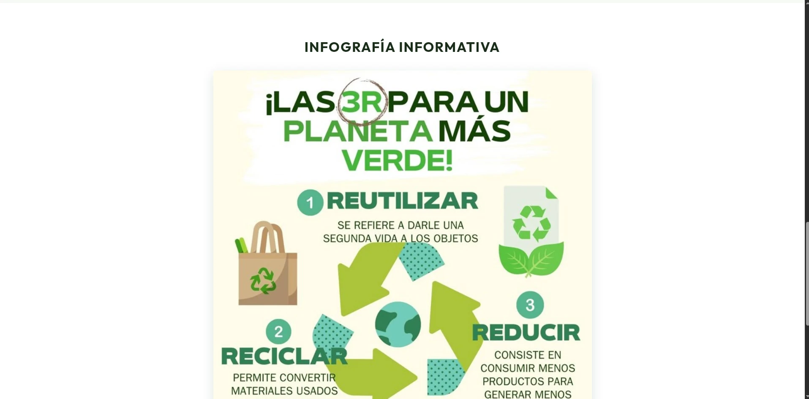

# EcoCampus — Informe de Prototipo
## Rama: experiment/survey-questions
**Universidad de Colima — Proyecto de Tesis**

---

## Indice

1. [Descripcion general del proyecto](#1-descripcion-general-del-proyecto)
2. [Tecnologias utilizadas](#2-tecnologias-utilizadas)
3. [Arquitectura del sistema](#3-arquitectura-del-sistema)
4. [Estructura del proyecto](#4-estructura-del-proyecto)
5. [Vistas de la aplicacion](#5-vistas-de-la-aplicacion)
   - 5.1 [Inicio (Landing Page)](#51-inicio-landing-page)
   - 5.2 [Calculadora de Huella Ecologica](#52-calculadora-de-huella-ecologica)
   - 5.3 [Mapa de Puntos de Reciclaje](#53-mapa-de-puntos-de-reciclaje)
   - 5.4 [Comunidad EcoCampus](#54-comunidad-ecocampus)
   - 5.5 [Guia de Reciclaje](#55-guia-de-reciclaje)
6. [Modo Experimento (rama experiment/survey-questions)](#6-modo-experimento-rama-experimentsurvey-questions)
   - 6.1 [Descripcion del experimento](#61-descripcion-del-experimento)
   - 6.2 [Acceso al estudio](#62-acceso-al-estudio)
   - 6.3 [Cuestionario del experimento](#63-cuestionario-del-experimento)
   - 6.4 [Guardado de respuestas](#64-guardado-de-respuestas)
   - 6.5 [Esquema de la base de datos](#65-esquema-de-la-base-de-datos)
7. [Backend (TypeScript)](#7-backend-typescript)
   - 7.1 [Estructura](#71-estructura)
   - 7.2 [Comandos](#72-comandos)
   - 7.3 [API (OpenAPI)](#73-api-openapi)
   - 7.4 [Respaldo y restauracion de MySQL](#74-respaldo-y-restauracion-de-mysql)
8. [Despliegue y entornos](#8-despliegue-y-entornos)
   - 8.1 [Entornos disponibles](#81-entornos-disponibles)
   - 8.2 [Desarrollo (Docker)](#82-desarrollo-docker)
   - 8.3 [Produccion (AWS Lightsail)](#83-produccion-aws-lightsail)
   - 8.4 [Despliegue automatico con GitHub Actions](#84-despliegue-automatico-con-github-actions)
   - 8.5 [Pruebas de carga (entorno aislado)](#85-pruebas-de-carga-entorno-aislado)
   - 8.6 [Sitio publico (GitHub Pages, rama main)](#86-sitio-publico-github-pages-rama-main)
9. [Pruebas](#9-pruebas)
   - 9.1 [Filosofia y tipos de prueba](#91-filosofia-y-tipos-de-prueba)
   - 9.2 [Comandos rapidos](#92-comandos-rapidos)
   - 9.3 [Suites de prueba](#93-suites-de-prueba)
   - 9.4 [Guia de pruebas de componentes con Vitest](#94-guia-de-pruebas-de-componentes-con-vitest)
10. [Pruebas sobre el servidor de produccion (AWS Lightsail)](#10-pruebas-sobre-el-servidor-de-produccion-aws-lightsail)
    - 10.1 [Rendimiento del cliente (Lighthouse)](#101-rendimiento-del-cliente-lighthouse)
    - 10.2 [WebPageTest](#102-webpagetest)
    - 10.3 [Peticiones de red del navegador](#103-peticiones-de-red-del-navegador)
    - 10.4 [Compatibilidad en navegadores y dispositivos](#104-compatibilidad-en-navegadores-y-dispositivos)
    - 10.5 [Carga concurrente](#105-carga-concurrente)
    - 10.6 [Endpoints evaluados](#106-endpoints-evaluados)
    - 10.7 [Servidor: hardware, logs y tiempos del backend](#107-servidor-hardware-logs-y-tiempos-del-backend)
    - 10.8 [Georreferenciacion de los contenedores](#108-georreferenciacion-de-los-contenedores)
    - 10.9 [Hallazgos y acciones recomendadas](#109-hallazgos-y-acciones-recomendadas)
11. [Animaciones de diseno (DESIGN.md)](#11-animaciones-de-diseno)
12. [Indice de documentacion de pruebas — Respuesta a la revision](#12-indice-de-documentacion-de-pruebas--respuesta-a-la-revision)

---

## 1. Descripcion general del proyecto

Aplicacion web para fomentar el reciclaje y la sostenibilidad en el campus de la Universidad de Colima. Permite calcular la huella ecologica personal, ubicar los puntos de reciclaje del campus en un mapa interactivo, consultar una guia de reciclaje y mantenerse informado sobre noticias y eventos ambientales de la comunidad universitaria.

Proyecto de tesis — Universidad de Colima.

La rama `experiment/survey-questions` corresponde al **modo experimento**: ademas del sitio publico, incluye login institucional (SAML) o acceso por correo, un cuestionario de evaluacion post-calculo y guardado de respuestas en MySQL en AWS Lightsail.

---

## 2. Tecnologias utilizadas

| Componente | Tecnologia | Version |
| :--- | :--- | :--- |
| Framework frontend | React | 19.0.0 |
| Bundler | Vite | 8.3.0 |
| Estilos | Tailwind CSS | 4.0.9 |
| Enrutamiento | React Router | 7.2.0 |
| Mapas | Leaflet / react-leaflet | 1.9.4 / 5.0.0 |
| Backend | Express + TypeScript | 4.22.2 / 7.0.2 |
| Validacion | Zod | 4.6.7 |
| Autenticacion | Passport + passport-saml | 0.5.2 / 5.1.0 |
| Base de datos | MySQL | 8 |
| Sesiones | express-session + mysql2 | 1.19.0 / 3.24.6 |
| Contenedores | Docker Compose | - |
| Proxy | Caddy (produccion), nginx (frontend) | - |
| Pruebas | Vitest / Playwright / k6 | 5.0.1 / 1.48.0 / - |
| CI/CD | GitHub Actions | - |

---

## 3. Arquitectura del sistema



El proyecto funciona de dos maneras:

- **Modo experimento (Docker en AWS Lightsail):** despliegue principal de esta rama. La SPA mas un backend Express, una base MySQL y login institucional corren en una instancia de Lightsail accesible por IP publica (`http://<IP>/ecocampus/`). Al terminar la calculadora, los participantes ven su resultado y responden un cuestionario que se guarda en MySQL. Se activa con `VITE_EXPERIMENTO_ACTIVO=true`.
- **Sitio publico (GitHub Pages):** SPA que corre solo en el cliente, sin backend ni API. Se publica automaticamente en cada push a `main`. No aplica a esta rama.

---

## 4. Estructura del proyecto

```
ecocampus/
+-- README.md, CLAUDE.md, SECURITY.md, INFORME_PROTOTIPO.md
+-- docker-compose.yml              base comun: MySQL, backend, frontend
+-- docker-compose.dev.yml          desarrollo
+-- docker-compose.prod.yml         produccion
+-- docker-compose.loadtest.yml     pruebas de carga
+-- .env.dev.example, .env.prod.example, .env.loadtest.example
+-- .github/workflows/
|   +-- test.yml                    CI: unit, backend, contrast, e2e, compatibilidad
|   +-- deploy.yml                  despliegue a GitHub Pages
|   +-- deploy-lightsail.yml        despliegue a AWS Lightsail
+-- backend/                        API en TypeScript (ver seccion 7)
+-- db/schema.sql                   esquema de la base de datos
+-- deploy/                         Caddyfile, scripts de despliegue
+-- loadtest/                       k6 y resultados
+-- docs/
|   +-- README.md                   indice de documentacion
|   +-- img/                        capturas de las vistas
|   +-- backend/                    documentacion del backend y API
|   +-- despliegue/                 entornos, produccion, Lightsail
|   +-- testing/                    guias de pruebas y reportes
|   +-- vista_1_inicio.md ... vista_5_guia_reciclaje.md
+-- frontend/
    +-- index.html                  entrada de Vite
    +-- vite.config.js              plugins, base y configuracion de Vitest
    +-- playwright.config.js        5 proyectos de navegador/dispositivo
    +-- e2e/                        pruebas E2E
    +-- public/                     assets estaticos
    +-- src/
        +-- App.jsx                 rutas
        +-- components/layout/      Navbar, Footer, PageLayout
        +-- config/                 experiment.js (modo experimento)
        +-- features/
        |   +-- landing/            LandingPage
        |   +-- calculadora/        Calculadora, cuestionario, preguntas
        |   +-- mapa/               Mapa interactivo
        |   +-- comunidad/          Noticias y eventos
        |   +-- guiaReciclaje/      Guia de reciclaje
        |   +-- auth/               LoginGate (modo experimento)
        +-- assets/
```

### Paginas

| Ruta | Componente | Descripcion |
| :--- | :--- | :--- |
| `/` | LandingPage | Introduccion a la huella ecologica |
| `/calculadora` | Calculadora | Cuestionario de 30 preguntas para medir el impacto ecologico |
| `/mapa` | Mapa | Mapa interactivo con 21 puntos de reciclaje del campus |
| `/comunidad` | Comunidad | Noticias y eventos ambientales |
| `/guia-reciclaje` | GuiaReciclaje | Principios y beneficios del reciclaje |

---

## 5. Vistas de la aplicacion

### 5.1 Inicio (Landing Page)

- **Ruta:** `/`
- **Componente:** `src/features/landing/LandingPage.jsx`

**Proposito**

Pagina de bienvenida que introduce el concepto de huella ecologica al usuario, presenta las herramientas de la plataforma y lo invita a usar la calculadora interactiva. Funciona como punto de entrada principal de la aplicacion.

**Captura de pantalla:**







**Estructura de la Vista**

- **Hero:** Ocupa toda la altura de la pantalla (`100dvh`). Usa el componente `PageHero` con imagen de fondo del campus de la UCOL, eyebrow "Plataforma ambiental universitaria", titulo "Calcula tu huella ecologica", descripcion "Conoce tu impacto ambiental y actua hoy" y boton CTA "Comenzar calculo" que navega a `/calculadora`. La navbar es transparente sobre el hero.

- **Seccion informativa (About):** Cuadricula de dos columnas con fondo blanco. Columna izquierda con eyebrow "Bienvenido a EcoCampus", titulo "¿Que es la huella ecologica?", dos parrafos de definicion y estadisticas:
  - Mexico: **3.1 hectareas globales** por persona (WWF)
  - Mexico ocupa el lugar 26 en PM2.5, con **20.1 ug/m3** de promedio
  - Columna derecha: imagen ilustrativa de huella ecologica.

- **Seccion de herramientas:** Cuadricula de 4 tarjetas con imagen de fondo:

| Herramienta | Ruta | Icono |
| :--- | :--- | :--- |
| Calculadora | `/calculadora` | Sprout |
| Mapa interactivo | `/mapa` | Map |
| Comunidad | `/comunidad` | Users |
| Guia de reciclaje | `/guia-reciclaje` | Recycle |

**Animaciones**

La vista usa el hook `useScrollReveal` con clases `reveal` y `reveal-card` para animar la entrada al hacer scroll. Las tarjetas tienen retraso escalonado de 80 ms entre cada una.

**Componentes utilizados**

| Componente | Archivo | Funcion |
| :--- | :--- | :--- |
| `PageLayout` | `src/components/layout/PageLayout.jsx` | Envuelve con Navbar y Footer; recibe `navTransparent` |
| `PageHero` | `src/components/ui/PageHero.jsx` | Bloque hero con imagen de fondo, eyebrow, titulo, descripcion y CTA |
| `CtaButton` | `src/components/ui/CtaButton.jsx` | Boton de accion primaria del hero |
| `SectionWrapper` | `src/components/ui/SectionWrapper.jsx` | Contenedor de seccion con padding y fondo configurables |
| `SectionHeading` | `src/components/ui/SectionHeading.jsx` | Encabezado de seccion con eyebrow y titulo |
| `FeatureCard` | `src/components/ui/FeatureCard.jsx` | Tarjeta de caracteristica |
| `IconCircle` | `src/components/ui/IconCircle.jsx` | Circulo con icono de lucide-react |
| `useScrollReveal` | `src/hooks/useScrollReveal.js` | Hook para animaciones de entrada al hacer scroll |

**Comportamiento y flujo**

1. El usuario llega a la pagina raiz `/`.
2. Ve el hero a pantalla completa con el CTA "Comenzar calculo".
3. Al hacer scroll, la seccion About y las estadisticas se revelan con animacion.
4. Mas abajo aparece la seccion de herramientas con 4 tarjetas.
5. Clic en "Comenzar calculo" o en la tarjeta "Calculadora" lleva a `/calculadora`.

---

### 5.2 Calculadora de Huella Ecologica

- **Ruta:** `/calculadora`
- **Componente:** `src/features/calculadora/Calculadora.jsx`
- **Datos de preguntas:** `src/features/calculadora/preguntas.js`
- **Validacion de pasos:** `src/features/calculadora/pasoRespondido.js`
- **Imagen ilustrativa:** `src/features/calculadora/ImagenTema.jsx`
- **Persistencia del progreso:** `src/features/calculadora/progresoGuardado.js`
- **Aviso flotante (toast):** `src/features/calculadora/ToastAviso.jsx`
- **Modal de confirmacion:** `src/features/calculadora/ModalConfirmacion.jsx`

**Proposito**

Cuestionario interactivo de 30 preguntas que evalua el impacto ecologico personal del usuario. Al finalizar, muestra un resultado desglosado por secciones con su equivalente en hectareas globales (hag) y numero de planetas.

Metodologia basada en: **Ibarra-Cisneros, J.M. & Monroy-Ata, A. (2014)**, adaptada al contexto mexicano.

**Vista 1 — Acceso (modo experimento activo)**

Cuando `VITE_EXPERIMENTO_ACTIVO=true`, la ruta `/calculadora` muestra primero un formulario de acceso antes de permitir responder las preguntas. Segun el valor de `REQUIERE_LOGIN`:

- `false` (modo correo): el participante escribe su correo institucional (`@ucol.mx`). El correo se normaliza (minusculas, sin `+alias`) y se valida contra `CORREO_DOMINIOS_PERMITIDOS`. No se envia ningun codigo de verificacion.
- `true` (modo SAML): el participante inicia sesion con su cuenta UCOL a traves del boton de login federado. Solo pasan cuentas con `uTipo = Estudiante`.


**Vista 2 — Cuestionario**

Una vez autenticado (o sin modo experimento), se muestra el cuestionario paso a paso:



**Secciones del cuestionario**

| Seccion | Preguntas | Temas evaluados |
| :--- | :--- | :--- |
| A - Alimentos | Q1 a Q15 | Frutas, verduras, pan, tortillas, carnes, mariscos, lacteos, bebidas, tabaco |
| B - Transporte | Q16 a Q20 | Metro, transporte colectivo, vuelos, automovil particular |
| C - Energia | Q21 a Q29 | Electrodomesticos, focos, telefonos moviles, dispositivos electronicos, tipo de calentador, duracion de regadera, habitos de agua |
| D - Forestal | Q30 | Cuadernos consumidos por semestre |

Ademas existe un paso especial de infraestructura previo a la seccion C donde se solicita el numero de habitantes del hogar, usado para dividir el consumo compartido de electrodomesticos y focos.

**Tipos de preguntas**

| Tipo interno | Descripcion | Preguntas afectadas |
| :--- | :--- | :--- |
| `unica` | Seleccion de una sola opcion (botones tipo toggle) | Mayoria de preguntas |
| `multipleCantidad` | Lista de alimentos con input numerico de frecuencia semanal | Q11 |
| `multipleCheckbox` | Seleccion multiple de electrodomesticos presentes en el hogar | Q21 |
| `cantidadDispositivo` | Input numerico para cantidad de telefonos moviles | Q24 |
| `multiGrupo` | Dropdown por tipo de dispositivo con horas semanales de uso | Q25 |
| `habitantesHogar` | Input numerico para numero de personas en el hogar | Paso especial antes de Q21 |

**Opcion nula** (para quien no consume o no usa ese tema, valor 0):

| Pregunta | Opcion nula |
| :--- | :--- |
| Q3 | No consumo pan |
| Q4 | No consumo tortilla |
| Q5 | No como carne de res |
| Q6 | No como carne de pollo |
| Q7 | No como carne de cerdo |
| Q8 | No como pescado ni mariscos |
| Q9 | No consumo yoghurt |
| Q10 | No tomo leche |
| Q15 | No consumo agua embotellada |
| Q16 | No uso el Metro |
| Q17 | No uso transporte colectivo |
| Q22 | No hay focos convencionales en mi casa |
| Q23 | No hay focos ahorradores en mi casa |
| Q26 | No tengo calentador / boiler |
| Q30 | No uso libretas |

**Seleccion obligatoria:** el boton "Siguiente" / "Finalizar" permanece deshabilitado hasta que el paso actual tenga respuesta.

---

### Listado completo de preguntas

**Seccion A: Alimentos (Q1 a Q15)**

| ID | Pregunta | Opciones (label — puntos) |
| :--- | :--- | :--- |
| Q1 | ¿Cuantas raciones de fruta consumes a la semana? (racion de 200 g) | Menos de una — 0; 1-2 — 2; 2-4 — 4; 4-6 — 6; 6-8 — 9 |
| Q2 | ¿Cuantas raciones de verdura consumes a la semana? (racion de 200 g) | Menos de una — 0; 1-2 — 1; 2-4 — 2; 4-6 — 4; 6-8 — 6 |
| Q3 | ¿Cuantas piezas de pan (dulce y/o salado) consumes a la semana? | No consumo pan — 0; 1-2 piezas — 27; 2-4 — 55; 4-6 — 93; 6-8 — 131; 8-10 — 170 |
| Q4 | ¿Que cantidad de tortilla consumes en promedio al dia (piezas)? | No consumo tortilla — 0; 1-2 piezas/dia — 91; 2-4 — 182; 4-6 — 295; 6-8 — 422; 8-10 — 542 |
| Q5 | ¿Cuantas veces a la semana consumes carne de res? | No como — 0; 1-2 veces/semana — 57; 2-4 — 121; 4-6 — 190; 6-8 — 267; 8-10 — 343 |
| Q6 | ¿Cuantas veces a la semana consumes carne de pollo? | No como — 0; 1-2 veces/semana — 234; 2-4 — 470; 4-6 — 789; 6-8 — 1,107 |
| Q7 | ¿Cuantas veces a la semana consumes carne de cerdo? | No como — 0; 1-2 veces/semana — 12; 2-4 — 25; 4-6 — 41; 6-8 — 140; 8-10 — 155 |
| Q8 | ¿Cuantas veces al mes consumes pescado y/o mariscos? | No como — 0; 1-2 veces/mes — 217; 2-4 — 425; 4-6 — 711; 6-8 — 998; 8-10 — 1,298 |
| Q9 | ¿Cuantas veces a la semana consumes yoghurt? (racion individual) | No consumo — 0; 1-2 veces/semana — 104; 3-4 — 243; 5-6 — 382; 7-8 — 521; 9-10 — 660 |
| Q10 | ¿Cuantas veces a la semana tomas leche? (racion de 250 mL) | No tomo — 0; 1-2 veces/semana — 130; 3-4 — 304; 5-6 — 478; 7-8 — 651; 9-10 — 825 |
| Q11 | ¿Cuales de los siguientes alimentos consumes durante una semana promedio? (puntos por vez/semana, se multiplica por las veces indicadas) | Cacahuates 60 g — 50; Papas fritas o frituras — 22; Quesadillas/tortas/gorditas — 347; Tacos orden de 3 — 240; Jugo de naranja natural — 242 |
| Q12 | ¿Cuantas veces a la semana tomas refresco? (base: lata de 355 mL) | No consumo — 0; 1-2 veces/semana — 1; 2-4 — 2; 4-6 — 4; 6-8 — 5; 8-10 — 7 |
| Q13 | ¿Cuantos cigarrillos fumas al dia? | No fumo — 0; 1 al dia — 3; 2-5 — 10; 6-10 — 24; 11-15 — 37; 16-20 — 52 |
| Q14 | ¿En cuanto estimas tu consumo semanal de cerveza? (base: lata de 355 mL) | No consumo — 0; 1-2/semana — 40; 2-4 — 79; 4-6 — 131; 6-8 — 186; 8-10 — 239 |
| Q15 | ¿Cuantos litros de agua embotellada consumes aproximadamente a la semana? | No consumo — 0; 1-2 L — 4; 3-4 — 10; 5-6 — 14; 7-8 — 20; 9-10 — 25 |

**Seccion B: Transporte (Q16 a Q20)**

| ID | Pregunta | Opciones (label — puntos) |
| :--- | :--- | :--- |
| Q16 | ¿Cuantos km recorres diariamente en el Sistema Colectivo Metro? (ida y vuelta) | No uso — 0; 2-6 km/dia — 68; 7-12 — 160; 13-18 — 260; 19-24 — 360; 25-30 — 470 |
| Q17 | ¿Cuantos km recorres diariamente en transporte colectivo (combi, microbus o autobus)? (ida y vuelta) | No uso — 0; 5-7 km/dia — 250; 8-10 — 380; 11-13 — 510; 14-16 — 630; 17-20 — 780 |
| Q18 | ¿Cuantas horas, en promedio, viajas en avion al año? (ida y vuelta) | No viajo — 0; menos de 2 h — 1,100; 2-7 h — 4,400; 7-15 h — 8,800; 15-25 h — 11,100; mas de 25 h — 22,200 |
| Q19 | ¿Cuentas con auto propio? | Si — 12,000; No — 0 |
| Q20 | ¿Que distancia recorres (km) en auto propio o taxi, diariamente? (ida y vuelta) | No uso — 0; 2-6 km/dia — 520; 7-12 — 1,200; 13-18 — 2,000; 19-24 — 2,800; 25-30 — 3,500 |

**Paso especial de infraestructura (antes de Q21)**

| Dato | Uso |
| :--- | :--- |
| Numero de habitantes del hogar (input numerico, minimo 1) | Divisor de las preguntas Q21 + Q22 + Q23 |

**Seccion C: Energia (Q21 a Q29)**

Nota de calculo: Q21 + Q22 + Q23 se suman entre si y el resultado se divide entre el numero de habitantes del hogar.

| ID | Pregunta | Opciones (label — puntos) |
| :--- | :--- | :--- |
| Q21 | De los siguientes electrodomesticos, si cuentas con ellos suma la cantidad indicada (checkbox multiple) | Plancha — 10; Licuadora — 11; Extractor de jugos — 6; Microondas — 56; Refrigerador — 4,400; Lavadora — 35 |
| Q22 | ¿Cuantos focos convencionales hay en tu casa? | No hay — 0; 1-3 — 190; 4-6 — 480; 7-9 — 780; 10-12 — 1,000; 13-15 — 1,300 |
| Q23 | ¿Cuantos focos ahorradores hay en tu casa? | No hay — 0; 1-3 — 78; 4-6 — 190; 7-9 — 310; 10-12 — 430; 13-15 — 540 |
| Q24 | ¿Cuentas con telefono celular propio? (si tienes mas de 1, multiplica por el numero de dispositivos) | Si (valor por dispositivo) — 76; No — 0 |
| Q25 | ¿Cuanto tiempo a la semana mantienes encendidos los siguientes aparatos electronicos? (se suman los 4 valores) | **Televisor:** 7h o menos — 28; 8-12h — 70; 13-17h — 100; 18-22h — 140; 23-28h — 170 / **Computadora:** 15-20h — 120; 21-25h — 160; 26-30h — 190; 31-35h — 230; 36-40h — 260 / **DVD:** 2-3h — 3; 4-6h — 6; 7-9h — 9; 10-12h — 12; 13-15h — 16 / **Estereo:** 2-3h — 9; 4-6h — 17; 7-9h — 28; 10-12h — 38; 13-15h — 48 |
| Q26 | Tu calentador o "boiler" utiliza: | No tengo — 0; Gas LP — 500; Gas natural — 400; Electricidad — 300 |
| Q27 | ¿Cuanto tiempo tardas en banarte? | Mas de 20 min — 910; 10-20 min — 450; 5-10 min — 223; Solo 5 min — 149 |
| Q28 | Cuando me lavo los dientes… | Dejo correr el agua — 6; Utilizo un vaso de agua — 1 |
| Q29 | ¿Cuantas veces por dia vacias el escusado o WC? | 2-3 veces/dia — 55; 4-6 — 108; 7-9 — 176; 10-12 — 240 |

**Seccion D: Forestal (Q30)**

| ID | Pregunta | Opciones (label — puntos) |
| :--- | :--- | :--- |
| Q30 | ¿Cuantas libretas profesionales de 100 hojas usas en un semestre? | No uso — 0; 2-3 libretas — 58; 3-4 — 81; 4-5 — 105; 5-6 — 128; 6-7 — 151 |

**Infraestructura**

Valor fijo de **6,400 puntos** que se suma una sola vez al puntaje total, independientemente de las respuestas.

**Calculo y resultado**

La funcion `calcularHuellaEcologica` recibe el objeto de respuestas y retorna `totalGeneral`, `totalAlimentos`, `totalTransporte`, `totalEnergia`, `totalForestal`, `infraestructura` e `interpretacion`.

**Niveles de sostenibilidad:**

| Puntos totales | Hectareas globales (hag) | Equivalente en planetas | Nivel |
| :--- | :--- | :--- | :--- |
| Menos de 16,000 | Menos de 1.6 hag | Menos de 1 planeta | Sostenible |
| 16,000 a 32,000 | 1.6 a 3.2 hag | Entre 1 y 2 planetas | En riesgo |
| Mas de 32,000 | Mas de 3.2 hag | Mas de 2 planetas | No sostenible |

**Tabla de conversion de puntos a hectareas globales y planetas:**

La formula de conversion es: `hag = puntos / 10,000` y `planetas = hag / 1.6`.

| Puntos totales | Hectareas globales (hag) | Planetas equivalentes | Nivel |
| ---: | ---: | ---: | :--- |
| 5,000 | 0.5 | 0.31 | Sostenible |
| 8,000 | 0.8 | 0.50 | Sostenible |
| 10,000 | 1.0 | 0.63 | Sostenible |
| 12,000 | 1.2 | 0.75 | Sostenible |
| 14,000 | 1.4 | 0.88 | Sostenible |
| **16,000** | **1.6** | **1.00** | **Limite sostenible / en riesgo** |
| 20,000 | 2.0 | 1.25 | En riesgo |
| 24,000 | 2.4 | 1.50 | En riesgo |
| 28,000 | 2.8 | 1.75 | En riesgo |
| **32,000** | **3.2** | **2.00** | **Limite en riesgo / no sostenible** |
| 36,000 | 3.6 | 2.25 | No sostenible |
| 40,000 | 4.0 | 2.50 | No sostenible |
| 48,000 | 4.8 | 3.00 | No sostenible |
| 56,000 | 5.6 | 3.50 | No sostenible |

Nota: el `totalGeneral` incluye un valor fijo de infraestructura de 6,400 puntos (calculado segun el numero de habitantes del hogar), por lo que el puntaje minimo posible no es 0.

**Persistencia en localStorage**

- Clave: `ecocampus:calculadora:v1`
- Valor: JSON `{ version: 1, respuestas, pasoActual, verResultado }`
- Todo acceso esta envuelto en `try/catch` para manejar modo privado, cuota llena o almacenamiento deshabilitado.

**Toast de progreso recuperado:** aparece si habia progreso guardado al cargar la pagina, con cierre automatico a 5 segundos, pausa al pasar el cursor o enfocar, y boton para borrar respuestas.

**Modal de confirmacion:** elemento nativo `<dialog>` con `showModal()`, soporte de Escape, clic en el fondo, rotacion de foco (Tab/Shift+Tab) y bloqueo de scroll.

**Botones de la pantalla de resultados:**

| Boton | Accion |
| :--- | :--- |
| Volver al Inicio | Enlace a `/`; el progreso sigue guardado |
| Contestar de nuevo | Borra el progreso y vuelve a la pregunta 1 |
| Revisar mis respuestas | Vuelve al ultimo paso conservando las respuestas |
| Continuar con el cuestionario | Solo con `EXPERIMENTO_ACTIVO`: abre el cuestionario del experimento |

**Accesibilidad:** botones con area de toque minima de 48 px, contraste WCAG AA, `role="status"` y `aria-live="polite"` en el toast, anillo de foco visible (`focus-visible:ring-4`), transiciones desactivadas con `@media (prefers-reduced-motion: reduce)`.

---

### 5.3 Mapa de Puntos de Reciclaje

- **Ruta:** `/mapa`
- **Componente:** `src/features/mapa/Mapa.jsx`
- **Datos:** `src/features/mapa/puntosReciclaje.js`
- **Icono personalizado:** `src/features/mapa/customIcon.js`

**Proposito**

Mapa interactivo que muestra la ubicacion exacta de los 21 contenedores de reciclaje fisicos del Campus Central de la Universidad de Colima. Cada marcador incluye una fotografia real del deposito para facilitar su identificacion en campo.

**Captura de pantalla:**



**Implementacion del mapa**

La vista usa **React Leaflet** con tiles de **OpenStreetMap**.

- Centro inicial: `[19.249437, -103.698893]` (Campus Central)
- Nivel de zoom inicial: `17`
- Tiles: `https://{s}.tile.openstreetmap.org/{z}/{x}/{y}.png`

**Icono personalizado (`customIcon.js`):**

| Propiedad | Valor |
| :--- | :--- |
| `iconUrl` | `src/assets/markpointMap.svg` |
| `iconSize` | `[18, 18]` px |
| `iconAnchor` | `[16, 32]` |
| `popupAnchor` | `[0, -32]` |

**Datos de los puntos (21 ubicaciones en el campus):**

Las zonas cubiertas incluyen: Facultades (Psicologia, Telematica, Letras, Medicina, Enfermeria, Trabajo Social, Mercadotecnia, Ciencias de la Educacion), areas de servicio (cafeterias, comedores), edificios administrativos (Servicios, Direccion General), espacios culturales (Auditorios, Radio Universidad), Bachillerato 1 y zonas internas (banos, aulas zona norte, laboratorios).

**Comportamiento:** al hacer clic en un marcador aparece un popup con el nombre de la ubicacion y la fotografia del contenedor.

**Georreferenciacion:** sistema WGS84, coordenadas geograficas en grados decimales, fotografia de cada deposito en `public/Depositos/`.

---

### 5.4 Comunidad EcoCampus

- **Ruta:** `/comunidad`
- **Componente:** `src/features/comunidad/Comunidad.jsx`
- **Datos:** `src/features/comunidad/noticiasEventos.js`

**Proposito**

Tablon de noticias y eventos ambientales orientado a mantener informada y conectada a la comunidad universitaria sobre las iniciativas ecologicas del campus.

**Captura de pantalla:**



**Estructura de la Vista**

- **Hero:** `PageHero` con eyebrow "Noticias y eventos ambientales", titulo "Comunidad EcoCampus" y descripcion "Mantente informado sobre eventos y noticias ambientales".
- **Cuadricula de tarjetas:** 3 columnas (1 columna en movil), cada tarjeta es un `FeatureCard` con animacion escalonada de 80 ms.

Cada tarjeta contiene: badge de tipo (Noticia/Evento), titulo, fecha e icono de fecha con descripcion.

**Contenido actual (datos de ejemplo):**

| ID | Titulo | Tipo | Fecha |
| :--- | :--- | :--- | :--- |
| 1 | Limpieza de playa - Manzanillo | Evento | 15 de febrero, 9:00 AM |
| 2 | Nueva estacion de reciclaje en campus | Noticia | 10 de febrero |
| 3 | Taller de compostaje domestico | Evento | 20 de febrero, 16:00 PM |

---

### 5.5 Guia de Reciclaje

- **Ruta:** `/guia-reciclaje`
- **Componente:** `src/features/guiaReciclaje/GuiaReciclaje.jsx`
- **Sub-componentes:** `HeroSection.jsx`, `PrinciplesSection.jsx`, `BenefitsSection.jsx`
- **Datos:** `src/features/guiaReciclaje/data.js`

**Proposito**

Seccion educativa e informativa sobre la importancia del reciclaje. Explica los principios de las 3 R's, enumera sus beneficios y enlaza a programas oficiales de la Universidad de Colima.

**Capturas de pantalla:**







**Estructura de la Vista**

- **Hero:** `PageHero` con boton CTA "Conoce mas" que enlaza al programa ReforestaAccion de la UdC (`https://portal.ucol.mx/siga/reforestaccion/`).
- **Banner informativo:** fondo `#f7f9f4` con icono `Leaf` y parrafo sobre el impacto positivo del reciclaje.

- **Las 3 R's (`PrinciplesSection`):**

| Numero | Nombre | Descripcion |
| :--- | :--- | :--- |
| 1 | Reciclar | Convertir materiales usados en nuevos productos |
| 2 | Reutilizar | Dar nueva vida a productos existentes sin modificarlos |
| 3 | Reducir | Disminuir el consumo y generacion de residuos |

- **Beneficios del Reciclaje (`BenefitsSection`):**

| Categoria | Contenido |
| :--- | :--- |
| Ambientales | Menos contaminacion, ahorro de agua y energia, conservacion de recursos naturales |
| Economicos | Generacion de empleo en la industria del reciclaje y reduccion de costos de produccion |
| Sociales | Entorno mas limpio y saludable, comunidades con mayor educacion ambiental |

- **Infografia:** imagen a ancho completo (maximo 896 px) cargada desde `public/infografia_guia.jpeg`.

---

## 6. Modo Experimento (rama experiment/survey-questions)

### 6.1 Descripcion del experimento

El modo experimento es opt-in: solo se activa con `VITE_EXPERIMENTO_ACTIVO=true` (leida en `frontend/src/config/experiment.js`). Sin la variable, como en el despliegue publico de GitHub Pages, la calculadora funciona normal sin login ni cuestionario.

Si esta activo, al pulsar "Finalizar" en la ultima pregunta se muestra primero la pantalla de resultados, con un bloque que invita a participar y el boton "Continuar con el cuestionario". Ese boton abre el cuestionario de evaluacion (`CuestionarioExperimento`) a pantalla completa.

### 6.2 Acceso al estudio

El acceso depende de `REQUIERE_LOGIN`:

| `REQUIERE_LOGIN` | Modo | Que ve el participante | Requisitos del servidor |
| :--- | :--- | :--- | :--- |
| `true` | `saml` | Boton "Iniciar sesion con UCOL". Solo pasan cuentas con `uTipo = Estudiante` | EntityID, callbacks y certificados registrados con sistemas@ucol.mx (variables `SAML_*`) y HTTPS |
| `false` | `correo` | Un campo para escribir el correo institucional | Solo el dominio `CORREO_DOMINIOS_PERMITIDOS` (por defecto `ucol.mx`) |

**Acceso por correo (`REQUIERE_LOGIN=false`):**
- `CORREO_DOMINIOS_PERMITIDOS` lista los dominios aceptados (tambien sus subdominios).
- Se normaliza el correo: minusculas y sin `+alias`.
- **No se verifica que el correo sea de quien lo escribe** (no se envia ningun codigo). Las defensas son el dominio, el indice `UNIQUE` y los logs.
- Cada fila guarda `metodo_acceso` (`saml` o `correo`) para separar los datos al analizar.

### 6.3 Cuestionario del experimento

**Tipos de pregunta:** `opcion_unica`, `select`, `numero` (con `min` y `max`), `texto_largo` y `escala_likert` (1 a 5).

**Secciones:**

| ID | Titulo | Contenido |
| :--- | :--- | :--- |
| `consentimiento` | Consentimiento informado | Texto de consentimiento + pregunta C1 ("¿Aceptas participar?"). Si el participante elige "No, gracias", vuelve a resultados. |
| `datos_generales` | Parte 1. Datos generales | Edad, sexo, carrera, semestre, conocimiento previo |
| `tarea` | Parte 2. Tarea | Completitud del calculo, pregunta abierta sobre dificultades |
| `usabilidad` | Parte 3. Usabilidad | 10 afirmaciones del cuestionario SUS en escala Likert 1-5 |
| `conciencia` | Parte 4. Conciencia percibida | 4 afirmaciones Likert 1-5 sobre impacto percibido |
| `intencion` | Parte 5. Intencion y utilidad | 2 afirmaciones Likert 1-5 sobre intencion de cambio |
| `abiertas` | Parte 6. Preguntas abiertas | 3 preguntas opcionales sobre habitos, mejoras y comentarios |

### 6.4 Guardado de respuestas

Al terminar el cuestionario se envia `POST {VITE_API_URL}/api/respuestas` con `respuestas`, `tiempoMin` y `planetas`. El backend:
- Toma el id y correo de la sesion (SAML o correo).
- Valida los datos con Zod.
- Inserta en la tabla `respuestas` de MySQL.
- Hay un solo registro por participante y por correo (indices `UNIQUE`).
- Un segundo envio devuelve `duplicado`.

El navegador nunca recibe correo, nombre ni numero de cuenta.

### 6.5 Esquema de la base de datos

```sql
CREATE TABLE IF NOT EXISTS respuestas (
  id                     INT UNSIGNED NOT NULL AUTO_INCREMENT,
  creado_en              DATETIME NOT NULL DEFAULT CURRENT_TIMESTAMP,
  participante_id        CHAR(16) NULL,
  correo                 VARCHAR(255) NULL,
  metodo_acceso          VARCHAR(10) NOT NULL DEFAULT 'saml',  -- 'saml' o 'correo'

  edad                   TINYINT UNSIGNED NOT NULL,
  sexo                   VARCHAR(30) NOT NULL,
  carrera                VARCHAR(80) NOT NULL,
  semestre               VARCHAR(2) NOT NULL,
  conocia_calculadora    VARCHAR(2) NOT NULL,
  completo_calculo       VARCHAR(2) NOT NULL,
  pregunta_sin_respuesta TEXT NULL,
  tiempo_min             SMALLINT UNSIGNED NOT NULL,
  planetas               VARCHAR(20) NOT NULL,

  -- SUS (u9-u18): 10 afirmaciones de usabilidad
  u9  TINYINT UNSIGNED NOT NULL, u10 TINYINT UNSIGNED NOT NULL, ..., u18 TINYINT UNSIGNED NOT NULL,
  -- Conciencia percibida (c19-c22): 4 afirmaciones
  c19 TINYINT UNSIGNED NOT NULL, ..., c22 TINYINT UNSIGNED NOT NULL,
  -- Intencion y utilidad (i23-i24): 2 afirmaciones
  i23 TINYINT UNSIGNED NOT NULL, i24 TINYINT UNSIGNED NOT NULL,

  habito_cambiar         TEXT NULL,
  mayor_dificultad       TEXT NULL,
  comentarios            TEXT NULL,

  PRIMARY KEY (id),
  UNIQUE KEY uq_participante (participante_id),
  UNIQUE KEY uq_correo (correo),
  CONSTRAINT ck_metodo_acceso CHECK (metodo_acceso IN ('saml', 'correo')),
  CONSTRAINT ck_edad CHECK (edad BETWEEN 15 AND 99),
  CONSTRAINT ck_likert CHECK (u9 BETWEEN 1 AND 5 AND ... AND i24 BETWEEN 1 AND 5)
) ENGINE=InnoDB DEFAULT CHARSET=utf8mb4;
```

**Migracion de base existente:** si la base existia antes de agregar `metodo_acceso`, aplicar `db/migraciones/001_metodo_acceso.sql`.

---

## 7. Backend (TypeScript)

El backend solo se usa en el **modo experimento** (Docker). Escrito en TypeScript estricto (`strict` y `noUncheckedIndexedAccess`) y se compila a `backend/dist/`.

### 7.1 Estructura

```
backend/src/
  server.ts            punto de entrada: carga la configuracion, espera a MySQL y escucha
  app.ts               arma la aplicacion de Express (crearApp); tambien la usan las pruebas
  config/              variables de entorno validadas con Zod
  auth/                estrategia SAML, correo (normalizacion y dominios) y derivacion del participante
  routes/              saml (login federado), acceso (por correo), sesion (/api/me), respuestas, salud y docs
  validacion/          esquema Zod de las respuestas: valida y genera el tipo de la fila a insertar
  openapi/             especificacion OpenAPI de la API y el generador de docs/openapi.json
  types/               declaraciones de tipos de TypeScript
  db.ts, logger.ts
```

### 7.2 Comandos

Ejecutar desde `backend/`:

| Comando | Para que sirve |
| :--- | :--- |
| `npm run dev` | Recarga en vivo con nodemon y tsx (lo usa el contenedor de desarrollo) |
| `npm run typecheck` | Comprueba los tipos sin generar archivos |
| `npm test` | Pruebas unitarias y de rutas (no necesitan MySQL ni el IdP) |
| `npm run build` | Compila a `dist/` |
| `npm run openapi` | Regenera `docs/openapi.json` a partir de la especificacion en el codigo |
| `npm start` | Ejecuta el JavaScript compilado (produccion) |

### 7.3 API (OpenAPI)

La API esta documentada con OpenAPI 3.1 (14 operaciones en cuatro grupos: respuestas, autenticacion, acceso por correo y sistema).

| Donde | Que |
| :--- | :--- |
| `docs/openapi.json` | Copia versionada de la especificacion; se puede abrir en editor.swagger.io |
| `http://localhost:4006/docs` | Swagger UI interactiva (solo en desarrollo) |
| `http://localhost:4006/openapi.json` | La especificacion servida por el backend |

La especificacion vive en el codigo (`backend/src/openapi/especificacion.ts`) y reutiliza las opciones y limites de la validacion, sin duplicar valores. Las pruebas fallan si la documentacion se desalinea del codigo.

**Parametros SAML fijos (credenciales de desarrollo):**

| Parametro | Valor |
| :--- | :--- |
| Puerto del backend | `4006` |
| `issuer` / EntityID | `http://localhost/20166932` |
| `callbackUrl` | `http://localhost:4006/login/callback` |
| `logoutCallbackUrl` | `http://localhost:4006/logout/callback` |
| `entryPoint` | `https://wayf.ucol.mx/saml2/idp/SSOService.php` |

Nota: Con estas credenciales de desarrollo el callback apunta a `localhost:4006`, asi que el login solo funciona en el navegador de la maquina que corre el backend.

### 7.4 Respaldo y restauracion de MySQL

```bash
# Respaldo (guardarlo fuera del servidor)
docker compose exec -T db sh -c 'mysqldump -uroot -p"$MYSQL_ROOT_PASSWORD" --single-transaction ecocampus' > respaldo_$(date +%F).sql

# Restauracion
docker compose exec -T db sh -c 'mysql -uroot -p"$MYSQL_ROOT_PASSWORD" ecocampus' < respaldo_AAAA-MM-DD.sql
```

Hacer un respaldo antes de iniciar el estudio y de forma periodica durante el. Si se pierde el volumen `db_data`, se pierden las respuestas.

---

## 8. Despliegue y entornos

### 8.1 Entornos disponibles

| Entorno | Para que sirve | Archivos de compose | Como se levanta |
| :--- | :--- | :--- | :--- |
| Desarrollo | Trabajar con recarga en vivo, BD y herramientas | base + dev | `docker compose up --build` |
| Produccion (Lightsail) | Servidor real con IP publica; experimento | base + prod | `docker compose up -d --build` |
| Pruebas de carga | Medir el rendimiento en entorno aislado | base + loadtest | ver seccion 8.5 |
| Sitio publico (GitHub Pages) | Solo frontend en rama `main` (sin backend) | no usa Docker | automatico en push a `main` |

Regla importante: **los compose no tienen valores por defecto**. Toda variable se carga del `.env` y, si falta o esta vacia, `docker compose` se detiene con un mensaje de error.

### 8.2 Desarrollo (Docker)

```bash
cp .env.dev.example .env
docker compose up --build
```

| Servicio | URL |
| :--- | :--- |
| Frontend (Vite, recarga en vivo) | http://localhost:5173/ecocampus/ |
| Backend (TypeScript con nodemon) | http://localhost:4006 |
| Swagger UI (API) | http://localhost:4006/docs |
| Adminer | http://localhost:8081 |
| phpMyAdmin | http://localhost:8082 |
| MySQL desde el equipo | 127.0.0.1:3307 |

**Frontend sin Docker:**
```bash
cd frontend
npm install
npm run dev
```
La app queda en http://localhost:5173/ecocampus/. Sin `VITE_API_URL` y `VITE_EXPERIMENTO_ACTIVO=true`, el modo experimento queda apagado.

### 8.3 Produccion (AWS Lightsail)

```bash
cp .env.prod.example .env   # completar TODAS las variables
docker compose up -d --build
```

- **Un solo punto de entrada:** el contenedor `proxy` (Caddy) es el unico que publica puertos (80 y 443). Reenvia `/api`, `/login`, `/logout` y `/Metadata` al backend y todo lo demas al frontend. MySQL, backend y frontend no se publican.
- **Sin dominio todavia:** `SITE_ADDRESS=:80`, el sitio se sirve por HTTP.
- **Con dominio:** `SITE_ADDRESS=tu.dominio`, URLs con `https://` y `COOKIE_SECURE=true`. Caddy obtiene y renueva el certificado HTTPS automaticamente.
- **Secretos obligatorios** en produccion: `SESSION_SECRET` (minimo 16 caracteres), `ID_SALT` y `DB_PASSWORD`. Generarlos con `openssl rand -hex 32`.
- **Operacion:** `restart: unless-stopped`, limites de memoria (MySQL 1 GB, backend 512 MB, el resto 128 MB) y rotacion de logs (3 archivos de 10 MB por servicio).
- **Herramientas de base de datos:** `docker compose --profile tools up -d` y acceso por tunel SSH.

### 8.4 Despliegue automatico con GitHub Actions

El flujo es:

```
push a experiment/survey-questions
  -> job "pruebas" (typecheck y pruebas del backend)
  -> aprobacion manual (Environment "production")
  -> job "desplegar": SSH al servidor, git checkout del commit,
     docker compose up -d --build
  -> verificacion; si falla, vuelve a la version anterior
```

**Archivos que intervienen:**

| Archivo | Para que sirve |
| :--- | :--- |
| `.github/workflows/deploy-lightsail.yml` | El workflow |
| `deploy/desplegar.sh` | Se ejecuta en el servidor: despliega, verifica y vuelve atras si falla |
| `deploy/preparar-servidor.sh` | Se ejecuta una sola vez en el servidor nuevo |

**Secrets de GitHub requeridos:**

| Secret | Valor |
| :--- | :--- |
| `LIGHTSAIL_HOST` | La IP estatica de la instancia |
| `LIGHTSAIL_USER` | `deploy` |
| `LIGHTSAIL_SSH_KEY` | Contenido completo de la llave privada `deploy_key` |
| `LIGHTSAIL_KNOWN_HOSTS` | Salida de `ssh-keyscan -t ed25519 TU_IP` |

**Como funciona cada despliegue:**
1. Push a `experiment/survey-questions` (los cambios solo en `docs/`, `loadtest/` o `.md` no lo disparan).
2. Corren `typecheck` y pruebas del backend. Si fallan, no se despliega.
3. GitHub espera aprobacion manual.
4. Workflow entra al servidor, hace checkout del commit y ejecuta `docker compose up -d --build`. Nunca usa `down` ni `-v`: los datos de MySQL se conservan.
5. Verifica durante hasta 3 minutos que el backend responda `/health`, nginx sirva el frontend y el proxy este activo.
6. **Si la construccion o verificacion fallan, vuelve a la version anterior.**

**Problemas frecuentes:**

| Sintoma | Causa y solucion |
| :--- | :--- |
| `Permission denied (publickey)` | La llave publica no esta en `/home/deploy/.ssh/authorized_keys` o el secret esta incompleto |
| `Host key verification failed` | `LIGHTSAIL_KNOWN_HOSTS` no corresponde a la IP del servidor |
| `el .env no apunta a docker-compose.prod.yml` | Falta o esta mal `COMPOSE_FILE` en el `.env` del servidor |
| La construccion se queda sin memoria | Instancia con poca RAM. Crear un swap de 2 GB o subir de plan |

### 8.5 Pruebas de carga (entorno aislado)

Se miden en un entorno aislado (`ecocampus-loadtest`) con su propio volumen de MySQL y sin puertos publicados, para no tocar los datos del estudio.

```bash
cp .env.loadtest.example .env.loadtest
docker compose stop   # liberar memoria
docker compose --env-file .env.loadtest -p ecocampus-loadtest \
  -f docker-compose.yml -f docker-compose.loadtest.yml up -d --build

MSYS_NO_PATHCONV=1 docker run --rm --network ecocampus-loadtest_default \
  -e PERFIL=carga -v "$(pwd -W)/loadtest:/scripts" grafana/k6 run \
  --summary-export=/scripts/results/resumen.json /scripts/k6.js

docker compose --env-file .env.loadtest -p ecocampus-loadtest \
  -f docker-compose.yml -f docker-compose.loadtest.yml down -v
docker compose start
```

- Perfiles: `carga` (hasta 100 usuarios virtuales, 3 min 21 s) y `estres` (hasta 300).
- El script es `loadtest/k6.js`.

### 8.6 Sitio publico (GitHub Pages, rama main)

Aplica unicamente a la rama `main`. El despliegue es automatico mediante `.github/workflows/deploy.yml` en cada push: usa Node 20, ejecuta `npm ci` y `npm run build`, y publica `frontend/dist`. No define variables de entorno, el modo experimento queda apagado.

La ruta base es `/ecocampus/`. Para que las rutas de la SPA funcionen en GitHub Pages se usa la tecnica de spa-github-pages: `public/404.html` redirige a la raiz y un script en `index.html` restaura la ruta original.

---

## 9. Pruebas

### 9.1 Filosofia y tipos de prueba

**Pruebas de componentes (Vitest + React Testing Library):**
- Smoke/render tests: verifican que un componente monta sin lanzar excepciones.
- Pruebas de comportamiento: interaccion con el DOM mediante roles ARIA (`getByRole`), reflejando lo que un usuario real ve y accede.

**Pruebas E2E (Playwright):**
- Flujos completos de la calculadora: desde el paso 1 hasta el resultado final.
- Pruebas de navegacion: avanzar, retroceder, validar encabezados y contadores de progreso.

El objetivo es detectar regresiones visibles para el usuario, no validar detalles de implementacion interna.

### 9.2 Comandos rapidos

```bash
# Pruebas de componentes (una vez) - desde frontend/
npm test

# Pruebas de componentes en modo watch
npm run test:watch

# Pruebas E2E (Playwright)
npm run test:e2e

# Solo compatibilidad (5 navegadores/dispositivos)
npx playwright test e2e/compatibilidad.spec.js

# Pruebas del backend - desde backend/
npm test
```

### 9.3 Suites de prueba

**Pruebas de componentes:**

| Archivo | Que cubre |
| :--- | :--- |
| `frontend/src/App.test.jsx` | Montaje de la aplicacion completa |
| `frontend/src/features/auth/LoginGate.test.jsx` | Pantalla de acceso en modo SAML y modo correo |
| `frontend/src/features/calculadora/Calculadora.test.jsx` | Seleccion obligatoria, imagen ilustrativa, persistencia, toast y modal |
| `frontend/src/features/calculadora/progresoGuardado.test.js` | Lectura, escritura, validacion y errores de localStorage |
| `frontend/src/features/comunidad/Comunidad.test.jsx` | Montaje, titulo hero, publicaciones y badges de tipo |
| `frontend/src/features/guiaReciclaje/GuiaReciclaje.test.jsx` | Montaje, titulo, 3 R's, beneficios y enlace externo |
| `frontend/src/features/landing/LandingPage.contrast.test.js` | Contraste WCAG 2.1 AA (calculo sin renderizar) |
| `frontend/src/features/landing/LandingPage.test.jsx` | Contenido y estructura de la pagina de inicio |
| `frontend/src/features/mapa/Mapa.test.jsx` | Montaje, titulo, contador de 21 puntos y subtitulo |
| `frontend/src/hooks/useScrollReveal.test.jsx` | Hook useScrollReveal: observacion, revelado y fallback |

**Pruebas E2E:**

| Archivo | Que cubre |
| :--- | :--- |
| `frontend/e2e/calculadora.spec.js` | Navegacion, flujos completos y validaciones (solo Chromium) |
| `frontend/e2e/compatibilidad.spec.js` | Vistas publicas en 5 perfiles (Chromium, Firefox, WebKit, Pixel 7, iPhone 14) |

**Pruebas del backend:**

| Archivo | Que cubre |
| :--- | :--- |
| `backend/src/app.test.ts` | Rutas HTTP con base de datos simulada |
| `backend/src/auth/correo.test.ts` | Normalizacion del correo y validacion de dominio |
| `backend/src/config/cargar.test.ts` | Configuracion tipada: conversion, valores invalidos, secretos obligatorios |
| `backend/src/openapi/especificacion.test.ts` | Especificacion OpenAPI alineada con el codigo |
| `backend/src/validacion/respuestas.test.ts` | Validacion de respuestas del cuestionario con Zod |

### 9.4 Guia de pruebas de componentes con Vitest

**Stack:** Vitest + React Testing Library + jest-dom. `globals: true` habilitado: no se necesitan importaciones para las APIs de Vitest.

**Problema de react-leaflet (ESM puro):** Vitest no puede transformarlo en el entorno jsdom. Dos patrones de mock:

Patron 1 — mockear el componente que usa react-leaflet (para probar un padre que importa `Mapa`):
```js
vi.mock('./features/mapa/Mapa', () => ({ default: () => null }));
```

Patron 2 — mockear react-leaflet directamente (para probar el propio componente `Mapa`):
```js
vi.mock("react-leaflet", () => ({
  MapContainer: () => null,
  TileLayer: () => null,
  Marker: () => null,
  Popup: () => null,
}));
```

**Componentes con React Router:** envolverlos en `MemoryRouter` al renderizar en pruebas.

**Queries preferidas:**
1. `getByRole` — refleja la semantica ARIA.
2. `getByText` — util para texto libre sin rol especifico.
3. `getByTestId` — ultimo recurso.

**Patron renderX():** encapsular el render con sus wrappers en una funcion auxiliar local para evitar repeticion.

**Cuando agregar nuevas pruebas:**
- Nueva vista o componente: agregar un archivo `.test.jsx` junto al componente. Como minimo, un smoke test y pruebas de los elementos ARIA principales.
- Nuevo flujo de calculadora: agregar un caso en `e2e/calculadora.spec.js`.
- Cambio de navegacion: agregar o actualizar una prueba E2E.

---

## 10. Pruebas sobre el servidor de produccion (AWS Lightsail)

- **URL probada:** `http://3.143.203.113/ecocampus/` (HTTP; sin dominio ni HTTPS todavia).
- **Version:** rama `experiment/survey-questions`, despues del PR #66.
- **Modo de acceso:** `correo` (`REQUIERE_LOGIN=false`).
- **Fecha:** 18 de octubre de 2026.
- **Mediciones:** desde un equipo en Colima, Mexico, hacia Lightsail en `us-east-2` (Ohio). Latencia minima de unos 60 ms por peticion.

### 10.1 Rendimiento del cliente (Lighthouse)

Lighthouse 13.5.0 con Chrome 155 sin interfaz, 3 corridas por combinacion (mediana), 3 paginas (inicio, calculadora, mapa) y 2 perfiles (movil y escritorio).

| Perfil | Pagina | Rendimiento | Accesibilidad | Buenas practicas | SEO | FCP (s) | LCP (s) | TBT (ms) | CLS | Peso (KB) |
| :--- | :--- | ---: | ---: | ---: | ---: | ---: | ---: | ---: | ---: | ---: |
| escritorio | inicio | 85 | 100 | 56 | 100 | 1.21 | 1.50 | 0 | 0.000 | 4118 |
| escritorio | calculadora | 87 | 94 | 78 | 100 | 1.20 | 1.38 | 0 | 0.016 | 491 |
| escritorio | mapa | 70 | 96 | 56 | 100 | 1.29 | 3.48 | 0 | 0.000 | 3122 |
| movil | inicio | 67 | 100 | 56 | 100 | 4.00 | 4.77 | 127 | 0.000 | 4118 |
| movil | calculadora | 60 | 98 | 78 | 100 | 3.48 | 5.07 | 0 | 0.176 | 491 |
| movil | mapa | 57 | 96 | 52 | 100 | 3.39 | 16.78 | 229 | 0.000 | 3050 |

**Hallazgos clave:**
- **Peso de imagenes:** Inicio transfiere ~4 MB; el mapa ~3 MB. Las fotos de los contenedores pesan ~1.5 MB cada una. El LCP de 16.8 s en el mapa en movil se debe a esto.
- **Sin HTTPS:** "Buenas practicas" baja (52 a 78) por 15 a 17 peticiones inseguras.
- **Cache:** Los archivos de `/assets/` ya se sirven con `Cache-Control: public, immutable` por un ano. Las imagenes propias y el manifest no tienen cache.
- **CLS:** 0.176 en la calculadora en movil, por encima del umbral recomendado de 0.1.

### 10.2 WebPageTest

Una corrida de la pagina de inicio por perfil (Chrome 152; escritorio 1024x681 y movil 393x659; primera visita):

| Metrica | Escritorio | Movil |
| :--- | ---: | ---: |
| TTFB | 37 ms | 143 ms |
| FCP | 858 ms | 1103 ms |
| LCP | 1055 ms | 1300 ms |
| Speed Index | 1384 ms | 1688 ms |
| TBT | 0 ms | 0 ms |
| CLS | 0 | 0 |
| Carga completa | 1423 ms | 1270 ms |
| Peticiones | 26 | 23 |
| Bytes recibidos | 4.27 MB | 0.54 MB |

Los Core Web Vitals quedan en rango bueno en ambos perfiles. En movil las fotos externas de Pexels y Unsplash no se descargan durante la carga.

### 10.3 Peticiones de red del navegador

Playwright (Chromium 153), 5 cargas en frio por pagina, sin cache:

| Pagina | Peticiones | Propias | Externas | Fallidas | HTTP 4xx/5xx | Transferido (KB) |
| :--- | ---: | ---: | ---: | ---: | ---: | ---: |
| `/ecocampus/` | 25 | 15 | 10 | 2 | 0 | 4099 |
| `/ecocampus/calculadora` | 15 | 11 | 4 | 0 | 0 | 473 |
| `/ecocampus/mapa` | 33 | 13 | 20 | 0 | 0 | 3104 |
| `/ecocampus/comunidad` | 19 | 14 | 5 | 0 | 0 | 749 |
| `/ecocampus/guia-reciclaje` | 21 | 16 | 5 | 0 | 0 | 1532 |

- Las 345 peticiones al servidor propio: media de 158 ms y p95 de 286 ms, sin fallos.
- Las 220 externas (OpenStreetMap, fuentes y el sitio de la universidad): media de 230 ms y p95 de 1038 ms.
- Los 75 mosaicos de OpenStreetMap: media de 281 ms, ninguno fallo.
- **Fallos:** 10 de 565 peticiones (1.8 %), todos la misma imagen externa `ucol.mx` bloqueada por el navegador (`net::ERR_BLOCKED_BY_ORB`). No hay ningun fallo en recursos propios.

### 10.4 Compatibilidad en navegadores y dispositivos

Playwright 1.63 contra el servidor de produccion. Resultado: **41 de 41 correctas**, 2 min 53 s.

| Proyecto | Motor y version | Sistema (agente de usuario) | Ventana | Tactil |
| :--- | :--- | :--- | :--- | :--- |
| `chromium` | Chromium 153.0.8010.12 | Windows 10/11 (real: Windows 11) | 1280x720 | No |
| `firefox` | Firefox 155.0 | Windows 10/11 | 1280x720 | No |
| `webkit` | WebKit 26.6 (motor de Safari) | macOS 10.15.7 (emulado) | 1280x720 | No |
| `movil-android-chrome` | Chromium 153, perfil Pixel 7 | Android 14 (emulado) | 412x839 | Si |
| `movil-ios-safari` | WebKit 26.6, perfil iPhone 14 | iOS 16.0 (emulado) | 390x664 | Emulado |

Cada perfil comprueba: inicio, acceso por correo (rechaza `@gmail.com`), calculadora (pregunta 1 y avance), mapa (21 marcadores, tiles y popup), comunidad, guia de reciclaje, ausencia de desbordamiento horizontal y la API.

**Limitaciones:** los perfiles de Safari y movil son emulados en Windows; no se probaron dispositivos fisicos ni Edge.

### 10.5 Carga concurrente

k6 con `loadtest/k6-produccion.js` (solo lecturas `GET`):

| Perfil | Usuarios max. | Duracion | Peticiones | Por segundo | Fallos | Media (ms) | p95 (ms) | p99 (ms) | Maximo (ms) |
| :--- | ---: | ---: | ---: | ---: | ---: | ---: | ---: | ---: | ---: |
| ligero | 10 | 1 min 20 s | 1741 | 21.5 | 0.00 % | 89 | 205 | 222 | 334 |
| medio | 30 | 1 min 50 s | 7363 | 66.7 | 0.00 % | 87 | 197 | 210 | 845 |
| cien | 100 | 2 min 50 s | 51 499 | 300.6 | 0.00 % | 87 | 195 | 203 | 638 |

**Escritura (`POST /api/respuestas`) con `k6-produccion-escritura.js`:**

| Perfil | Usuarios max. | Duracion | Respuestas guardadas | Por segundo | Fallos | Acceso: p95 (ms) | Envio: p95 (ms) |
| :--- | ---: | ---: | ---: | ---: | ---: | ---: | ---: |
| ligero | 10 | 1 min 20 s | 366 | 9.1 | 0.00 % | 153 | 117 |
| medio | 30 | 1 min 50 s | 1611 | 29.2 | 0.00 % | 125 | 102 |
| cien | 100 | 2 min 50 s | 10 989 | 64.4 resp/s | 0.00 % | 212 | 193 |

Con 100 usuarios la CPU llego como maximo a 48.1 % de los 2 vCPU. Los tiempos no crecieron al triplicar los usuarios de 30 a 100.

### 10.6 Endpoints evaluados

| Endpoint | Metodo | Se evaluo con | Resultado |
| :--- | :--- | :--- | :--- |
| `/api/me` | GET | k6 (carga) y Playwright | 200 en todas las peticiones; media 65 ms |
| `/api/acceso/correo` | POST | Playwright y k6 (escritura) | 403 con dominio ajeno; 200 con `@ucol.mx` en 1977 iteraciones |
| `/api/respuestas` | POST | Playwright (sin sesion) y k6 | 401 sin sesion; 201 en 1977 escrituras de carga |
| `/ecocampus/`, `/calculadora`, `/mapa` | GET | k6 y Lighthouse | 200; media 64 ms |
| Archivos JS y CSS | GET | k6 | 200; JS 192 ms, CSS 68 ms |

### 10.7 Servidor: hardware, logs y tiempos del backend

Datos tomados el 18 de octubre de 2026, 07:21 UTC.

| Recurso | Valor |
| :--- | :--- |
| Sistema operativo | Ubuntu 24.04.4 LTS (kernel 7.0.0-1012-aws) |
| CPU | 2 vCPU, Intel Xeon Platinum 8259CL a 2.5 GHz |
| Memoria | 1906 MB en total, sin swap; 845 MB disponibles en reposo |
| Disco | 58 GB, 11 % usado (6.2 GB) |
| Docker | 29.9.1; Compose v5.6.0 |
| Region | AWS Lightsail `us-east-2` |

**Uso en reposo:**

| Contenedor | CPU | Memoria | Limite | Reinicios |
| :--- | ---: | ---: | ---: | ---: |
| `db` (MySQL 8.0) | 0.61 % | 375 MiB | 1 GiB | 0 |
| `backend` | 0.01 % | 42.8 MiB | 512 MiB | 0 |
| `proxy` (Caddy) | 0.00 % | 20.4 MiB | 128 MiB | 0 |
| `frontend` (nginx) | 0.00 % | 4.0 MiB | 128 MiB | 0 |

**Distribucion de tiempos del backend (log de las ultimas 24 h):**

| Endpoint | Peticiones | 2xx/3xx | 4xx | 5xx | Media (ms) | p50 | p95 | p99 | Maximo |
| :--- | ---: | ---: | ---: | ---: | ---: | ---: | ---: | ---: | ---: |
| `GET /api/me` | 1597 | 1597 | 0 | 0 | 1 | 1 | 1 | 2 | 24 |
| `GET /health` | 467 | 467 | 0 | 0 | 2 | 2 | 4 | 7 | 49 |
| `POST /api/acceso/correo` | 27 | 16 | 11 | 0 | 9 | 9 | 29 | 48 | 48 |
| `POST /api/respuestas` | 12 | 1 | 11 | 0 | 3 | 1 | 28 | 28 | 28 |

No hubo ningun error 5xx. El backend atiende en 1 a 2 ms las lecturas; los ~65 ms medidos desde el cliente son casi todos de red.

**CPU y memoria durante 100 usuarios simultaneos:**

| Fase | CPU del servidor media/max | CPU robada | MySQL | Backend | Proxy | Memoria usada (max.) | Disponible (min.) |
| :--- | ---: | ---: | ---: | ---: | ---: | ---: | ---: |
| Reposo | 5.2 % / 8.0 % | 0.0 % | 1.4 % | 0.0 % | 0.0 % | 1122 MB | 785 MB |
| Lectura, 100 usuarios | 20.7 % / 28.5 % | 0.1 % | 1.4 % | 6.4 % | 15.6 % | 1141 MB | 765 MB |
| Escritura, 100 usuarios | 37.5 % / 48.1 % | 0.1 % | 16.9 % | 32.1 % | 9.8 % | 1150 MB | 756 MB |

Conclusion: **el servidor no se saturo** con 100 usuarios simultaneos. La memoria no crece significativamente y siempre quedaron al menos 756 MB disponibles.

### 10.8 Georreferenciacion de los contenedores

Validacion automatica con `validar-georreferencia.mjs`:

- 21 puntos validos, todos con latitud/longitud validas y fotografia en `frontend/public/Depositos/`.
- Caja envolvente: 463 m (este-oeste) por 356 m (norte-sur) — consistente con el tamano del Campus Central.
- Todos a 306 m o menos del centro del mapa.
- Distancia minima entre dos puntos: 13.9 m; ningun punto duplicado.
- La precision de los decimales (hasta 15) excede la del GPS de un telefono (unos 3 a 5 m).

**Origen de los datos:** las coordenadas las tomo el primer equipo que desarrollo el proyecto. Ese equipo no dejo registrado como las obtuvo, la fecha ni el margen de error.

### 10.9 Hallazgos y acciones recomendadas

| Prioridad | Hallazgo | Accion |
| :--- | :--- | :--- |
| Alta | Inicio pesa 4 MB en escritorio por dos fotos externas descargadas a 3000 px; el mapa en movil tiene LCP de 16.8 s | Servir fotos ya redimensionadas en WebP a ~600 px; comprimir fotos del mapa (WebP, max 800 px) |
| Alta | Sin HTTPS | Dominio y HTTPS con Caddy; mejora "buenas practicas" y es requisito del login federado |
| Media | Imagenes propias y manifest sin `Cache-Control` | Cache larga tambien para `/Logos/`, `/Depositos/` y el favicon |
| Media | Imagen de `ucol.mx` bloqueada en inicio (10 de 565 peticiones) | Copiarla al proyecto o quitarla |
| Media | Una redireccion de ~1.1 s en movil | Identificar cual es (probablemente `/ecocampus` a `/ecocampus/`) y evitarla |
| Baja | CLS de 0.176 en la calculadora en movil | Reservar el tamano de la imagen de cada pregunta |
| Media | Servidor de 1.9 GB de RAM sin swap; MySQL usa 375 MiB en reposo | Vigilar la memoria durante el estudio; subir de plan o agregar swap si hay picos |
| Baja | Procedimiento de georreferenciacion sin confirmar | Completar la seccion con quien capturo las coordenadas |

---

## 11. Animaciones de diseno

**Especificacion de las animaciones de la LandingPage (`DESIGN.md`)**

Animaciones de entrada al hacer scroll en la pagina de inicio, siguiendo el estilo soft-skill / Awwwards-tier con fisica de resorte, blur fade-up y coreografia escalonada.

**Principio general (blur-fade-up):**

- Estado inicial: `opacity: 0; transform: translateY(40px); filter: blur(6px)`
- Estado final: `opacity: 1; transform: translateY(0); filter: blur(0)`
- Curva de timing: `cubic-bezier(0.32, 0.72, 0, 1)` (simulacion de resorte amortiguado)
- Duracion base: `700ms`
- Solo `transform` y `opacity` para GPU; el blur se aplica con `filter` durante la entrada.

**Implementacion:** `IntersectionObserver` nativo en el hook `useScrollReveal`:
- `threshold: 0.15` — activa cuando el 15% del elemento esta visible.
- `triggerOnce: true` — no repite la animacion al hacer scroll de vuelta.

**Coreografia por seccion:**

- **Hero:** animacion de entrada en carga (fade-up stagger): eyebrow 0ms, titulo 100ms, descripcion 200ms, CTA button 300ms.
- **Seccion About (grid 2 col):** columna texto desde Y+40 con delay 0ms, columna imagen con delay 150ms, estadisticas internas con stagger de 80ms.
- **Seccion Herramientas:** SectionHeading con delay 0ms, cada FeatureCard con stagger de 80ms (0ms, 80ms, 160ms, 240ms), desde `translateY(32px)`.

**Restricciones:**
- No usar Framer Motion ni librerias de animacion externas — solo CSS + IntersectionObserver.
- No animar `top`, `left`, `width`, `height` — solo `transform` y `opacity` (+ `filter` durante entrada).
- `will-change: transform` solo durante la animacion activa.
- Las animaciones se desactivan con `@media (prefers-reduced-motion: reduce)`.

**Paleta existente (mantener):**

| Token | Valor | Uso |
| :--- | :--- | :--- |
| `hero-bg` | imagen con overlay verde | Hero section |
| `section-white` | `#ffffff` | Seccion About |
| `accent-green` | `#4a7c59` | Textos de enfasis, iconos |
| `heading-dark` | `#1a2e1a` | Titulos principales |
| `body-text` | `#3a4a3a` | Texto de cuerpo |
| `stat-green` | `#2d6a2d` | Cifras estadisticas destacadas |

**Archivos a modificar:**

| Archivo | Cambio |
| :--- | :--- |
| `frontend/src/features/landing/LandingPage.jsx` | Aplicar hook/clases de scroll reveal a secciones |
| `frontend/src/hooks/useScrollReveal.js` | Nuevo hook con IntersectionObserver |
| `frontend/src/styles/scroll-animations.css` | Clases CSS utilitarias para estados de animacion |

---

## 12. Indice de documentacion de pruebas — Respuesta a la revision

El siguiente cuadro es la respuesta punto por punto a la revision recibida sobre las pruebas, justificando por que antes no aplicaban y ahora si (el sitio corre en un servidor propio de AWS Lightsail, no en un hosting estatico).

### Pruebas que antes no aplicaban (GitHub Pages) y ahora si (AWS Lightsail)

| Punto de la revision | Respuesta | Donde esta |
| :--- | :--- | :--- |
| Numero de solicitudes al servidor y endpoints evaluados | Lectura: 1741 peticiones (10 usuarios) y 7363 (30 usuarios). Escritura: 732 (10 usuarios) y 3222 (30 usuarios). Todos respondieron con el codigo esperado | Seccion 10.6 |
| Logs del servidor y distribucion de tiempos de respuesta del backend | 2103 peticiones en el log del backend (24 h): lecturas en 1 a 2 ms (p95 de `/api/me` 1 ms), `POST /api/acceso/correo` con p95 de 29 ms y `POST /api/respuestas` con p95 de 28 ms. Cero errores 5xx | Seccion 10.7 |
| Hardware y red del servidor | Ubuntu 24.04, 2 vCPU Intel Xeon Platinum 8259CL a 2.5 GHz, 1.9 GB de RAM sin swap, disco 58 GB. Lightsail `us-east-2`. Red: ~60 ms de latencia minima desde Colima hasta Ohio | Seccion 10.7 |
| Pruebas de carga concurrente | Hasta 100 usuarios virtuales simultaneos: lectura a 300.6 peticiones/s (0% fallos, p95 195 ms) y escritura con 10 989 respuestas guardadas a 64.4/s (0% fallos, p95 200 ms). CPU maxima 48.1% | Secciones 10.5 y 10.7 |

### Respuestas a las pruebas planeadas

| Prueba planeada | Resultado | Donde esta |
| :--- | :--- | :--- |
| Rendimiento con Lighthouse y WebPageTest | Rendimiento 57-67 en movil y 70-87 en escritorio; accesibilidad 94-100; SEO 100; WebPageTest: LCP 1.06 s (escritorio) y 1.30 s (movil), TBT 0, CLS 0 | Secciones 10.1 y 10.2 |
| Registro de peticiones de red del navegador | 565 peticiones, media 158 ms (propias) y 230 ms (externas), p95 286 ms. Fallos: 1.8% (imagen de ucol.mx bloqueada) | Seccion 10.3 |
| Compatibilidad en Chrome, Firefox, Edge y Safari | 41 de 41 correctas. Chromium, Firefox, WebKit (Safari emulado), Pixel 7 y iPhone 14 | Seccion 10.4 |
| Documentacion de la georreferenciacion | 21 puntos validos, caja de 463 m x 356 m, distancia minima 13.9 m, sin duplicados, todos con foto | Seccion 10.8 |

### Limitaciones declaradas

- Las mediciones se hicieron desde un solo equipo (Windows 11, AMD Ryzen 5 5500U) en Colima, hacia el servidor en Ohio; los tiempos incluyen la red.
- WebPageTest se corrio una sola vez por perfil y solo en la pagina de inicio; Edge y dispositivos fisicos no se probaron.
- Los datos del servidor en reposo y del log son de un instante.
- La escritura se probo sobre la base de produccion con datos de prueba que se borran despues.
- El sitio se sirve por HTTP, sin dominio ni HTTPS; esto afecta la puntuacion de "buenas practicas" de Lighthouse.
- Las pruebas de carga son de pocos minutos y no miden degradacion a largo plazo.

---

*Informe generado a partir de la documentacion completa de la rama `experiment/survey-questions`.*
*Universidad de Colima — Proyecto de Tesis EcoCampus.*
