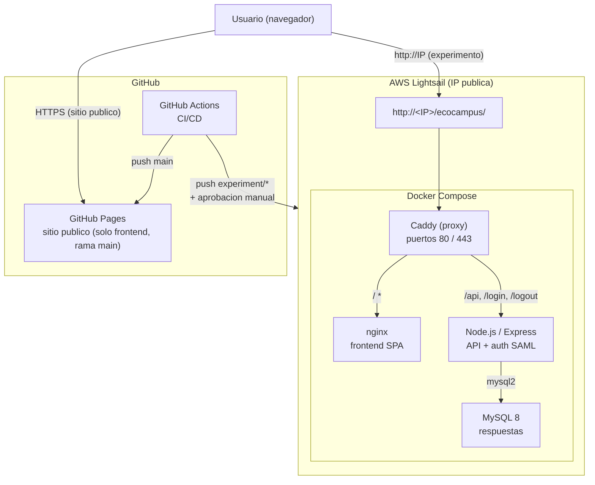

# EcoCampus

[](https://github.com/SEBASTIANTORRESL0K1/ecocampus/actions/workflows/test.yml)

Aplicacion web para fomentar el reciclaje y la sostenibilidad en el campus de la Universidad de Colima. Permite calcular la huella ecologica personal, ubicar los puntos de reciclaje del campus en un mapa interactivo, consultar una guia de reciclaje y mantenerse informado sobre noticias y eventos ambientales de la comunidad universitaria.

Proyecto de tesis -- Universidad de Colima.

---

## Tecnologias

| Componente | Tecnologia | Version |
| :--- | :--- | :--- |
| Framework frontend | [React](https://react.dev/) | 19.0.0 |
| Bundler | [Vite](https://vite.dev/) | 8.3.0 |
| Estilos | [Tailwind CSS](https://tailwindcss.com/) | 4.0.9 |
| Enrutamiento | [React Router](https://reactrouter.com/) | 7.2.0 |
| Mapas | [Leaflet](https://leafletjs.com/) / [react-leaflet](https://react-leaflet.js.org/) | 1.9.4 / 5.0.0 |
| Backend | [Express](https://expressjs.com/) + [TypeScript](https://www.typescriptlang.org/) | 4.22.2 / 7.0.2 |
| Validacion | [Zod](https://zod.dev/) | 4.6.7 |
| Autenticacion | [Passport](https://www.passportjs.org/) + [passport-saml](https://github.com/node-saml/passport-saml) | 0.5.2 / 5.1.0 |
| Base de datos | MySQL | 8 |
| Sesiones | [express-session](https://github.com/expressjs/session) + [mysql2](https://github.com/sidorares/node-mysql2) | 1.19.0 / 3.24.6 |
| Contenedores | Docker Compose | - |
| Proxy | Caddy (produccion), nginx (frontend) | - |
| Pruebas | [Vitest](https://vitest.dev/) / [Playwright](https://playwright.dev/) / [k6](https://k6.io/) | 5.0.1 / 1.48.0 / - |
| CI/CD | GitHub Actions | - |

---

## Vistas de la aplicacion

### Inicio (Landing Page)

Introduccion al concepto de huella ecologica y puerta de acceso al cuestionario interactivo.


### Calculadora de Huella Ecologica

Cuestionario interactivo de 30 preguntas basado en metodologia cientifica mexicana para evaluar y desglosar el impacto ecologico del usuario. En el modo experimento pide login institucional y al finalizar muestra el resultado seguido de un cuestionario de evaluacion.


### Mapa de Puntos de Reciclaje

Mapa georreferenciado e interactivo que ubica los 21 contenedores de reciclaje fisicos del campus central, acompanados de fotos reales para su facil identificacion.


### Comunidad EcoCampus

Tablon de noticias y eventos ecologicos para mantener conectada a la comunidad universitaria con las acciones ambientales de su entorno.


### Guia de Reciclaje

Seccion informativa y visual sobre las 3 R's de la ecologia, beneficios del reciclaje y enlaces a programas oficiales de la Universidad de Colima.


---

## Arquitectura en produccion



El proyecto funciona de dos maneras:

- **Modo experimento (Docker en AWS Lightsail):** despliegue principal de esta rama. La SPA mas un backend Express, una base MySQL y login institucional corren en una instancia de Lightsail accesible por IP publica (`http://<IP>/ecocampus/`). Al terminar la calculadora, los participantes ven su resultado y responden un cuestionario que se guarda en MySQL. Se activa con `VITE_EXPERIMENTO_ACTIVO=true`. Ver [docs/despliegue/lightsail.md](docs/despliegue/lightsail.md).
- **Sitio publico (GitHub Pages):** SPA que corre solo en el cliente, sin backend ni API. Se publica automaticamente en cada push a `main`. No aplica a esta rama.

---

## Estructura del proyecto

```
ecocampus/
+-- README.md, CLAUDE.md, SECURITY.md
+-- docker-compose.yml              base comun: MySQL, backend, frontend
+-- docker-compose.dev.yml          desarrollo
+-- docker-compose.prod.yml         produccion
+-- docker-compose.loadtest.yml     pruebas de carga
+-- .env.dev.example, .env.prod.example, .env.loadtest.example
+-- .github/workflows/
|   +-- test.yml                    CI: unit, backend, contrast, e2e, compatibilidad
|   +-- deploy.yml                  despliegue a GitHub Pages
|   +-- deploy-lightsail.yml        despliegue a AWS Lightsail
+-- backend/                        API en TypeScript (ver docs/backend/)
+-- db/schema.sql                   esquema de la base de datos
+-- deploy/                         Caddyfile, scripts de despliegue
+-- loadtest/                       k6 y resultados
+-- docs/
|   +-- README.md                   indice de documentacion
|   +-- img/                        capturas de las vistas
|   +-- backend/                    documentacion del backend y API
|   +-- despliegue/                 entornos, produccion, Lightsail
|   +-- testing/                    guias de pruebas y reportes
|   +-- vista_1_inicio.md ... vista_5_guia_reciclaje.md
+-- frontend/
    +-- index.html                  entrada de Vite
    +-- vite.config.js              plugins, base y configuracion de Vitest
    +-- playwright.config.js        5 proyectos de navegador/dispositivo
    +-- e2e/                        pruebas E2E
    +-- public/                     assets estaticos
    +-- src/
        +-- App.jsx                 rutas
        +-- components/layout/      Navbar, Footer, PageLayout
        +-- config/                 experiment.js (modo experimento)
        +-- features/
        |   +-- landing/            LandingPage
        |   +-- calculadora/        Calculadora, cuestionario, preguntas
        |   +-- mapa/               Mapa interactivo
        |   +-- comunidad/          Noticias y eventos
        |   +-- guiaReciclaje/      Guia de reciclaje
        |   +-- auth/               LoginGate (modo experimento)
        +-- assets/
```

---

## Paginas

| Ruta | Componente | Descripcion |
| :--- | :--- | :--- |
| `/` | LandingPage | Introduccion a la huella ecologica |
| `/calculadora` | Calculadora | Cuestionario de 30 preguntas para medir el impacto ecologico |
| `/mapa` | Mapa | Mapa interactivo con 21 puntos de reciclaje del campus |
| `/comunidad` | Comunidad | Noticias y eventos ambientales |
| `/guia-reciclaje` | GuiaReciclaje | Principios y beneficios del reciclaje |

---

## Inicio rapido

### Frontend sin Docker

```bash
cd frontend
npm install
npm run dev
```

La app queda en [http://localhost:5173/ecocampus/](http://localhost:5173/ecocampus/).

### Con Docker (frontend + backend + MySQL)

```bash
cp .env.dev.example .env
docker compose up --build
```

Detalles de todos los entornos en [docs/despliegue/](docs/despliegue/README.md).

---

## Pruebas

| Tipo | Herramienta | Comando |
| :--- | :--- | :--- |
| Componentes y unitarias (frontend) | Vitest + React Testing Library | `npm test` en `frontend/` |
| Unitarias y rutas (backend) | `node:test` + tsx | `npm test` en `backend/` |
| E2E | Playwright | `npm run test:e2e` en `frontend/` |
| Carga | k6 | ver [docs/despliegue/](docs/despliegue/README.md#pruebas-de-carga) |

Guias detalladas en [docs/testing/](docs/testing/README.md).

---

## Documentacion

| Tema | Enlace |
| :--- | :--- |
| Indice de documentacion | [docs/README.md](docs/README.md) |
| Backend y API | [docs/backend/](docs/backend/README.md) |
| Despliegue y entornos | [docs/despliegue/](docs/despliegue/README.md) |
| Despliegue en AWS Lightsail | [docs/despliegue/lightsail.md](docs/despliegue/lightsail.md) |
| Pruebas | [docs/testing/](docs/testing/README.md) |
| Vista: Inicio | [docs/vista_1_inicio.md](docs/vista_1_inicio.md) |
| Vista: Calculadora | [docs/vista_2_calculadora.md](docs/vista_2_calculadora.md) |
| Vista: Mapa | [docs/vista_3_mapa.md](docs/vista_3_mapa.md) |
| Vista: Comunidad | [docs/vista_4_comunidad.md](docs/vista_4_comunidad.md) |
| Vista: Guia de reciclaje | [docs/vista_5_guia_reciclaje.md](docs/vista_5_guia_reciclaje.md) |
