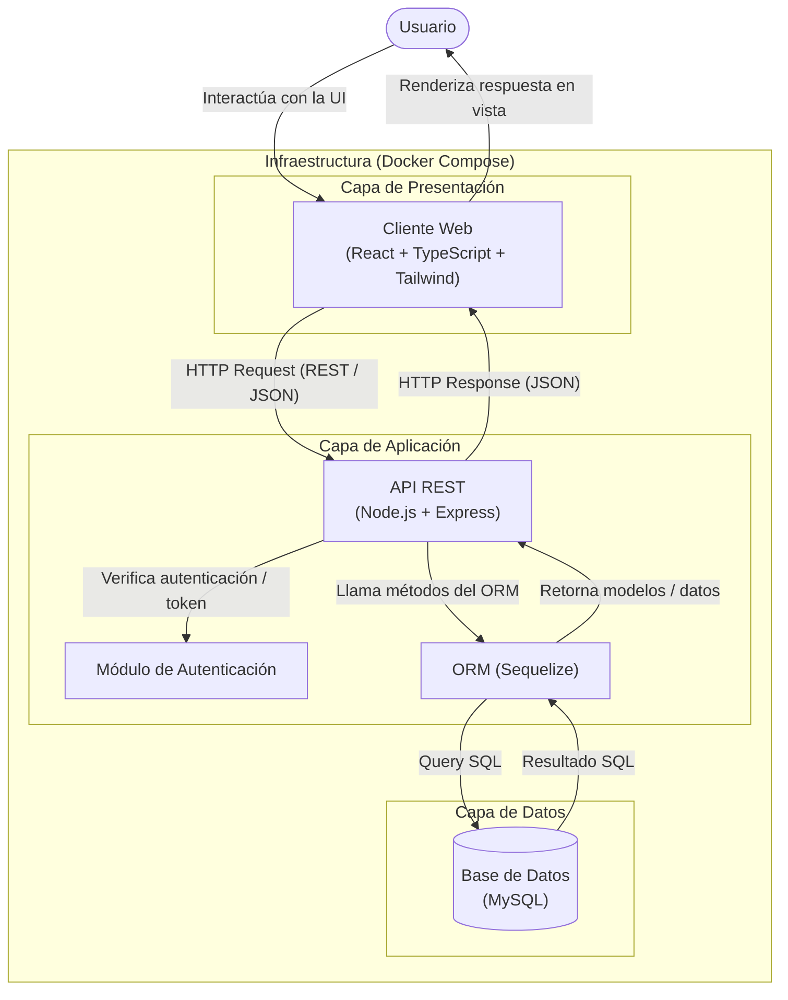

# Arquitectura del Sistema

Este documento describe la arquitectura del sistema, el flujo de datos entre capas y la infraestructura que soporta la solución.

---

## 1. Ficha Técnica

| Capa / Componente | Tecnologías | Descripción / Rol |
| :--- | :--- | :--- |
| **Frontend / Cliente** | React, TypeScript, Tailwind CSS | Interfaz de usuario declarativa y responsiva para la interacción directa del usuario. |
| **Backend / API** | Node.js, Express | API REST encargada del manejo de peticiones, autenticación, lógica de negocio y control de acceso. |
| **ORM / Mapeo de Datos** | Sequelize | Abstracción de base de datos para modelado, validaciones y ejecución de consultas SQL. |
| **Base de Datos** | MySQL | Sistema gestor de base de datos relacional para la persistencia transaccional y consistente de la información. |
| **Infraestructura** | Docker Compose | Orquestación y contenedorización de los servicios para despliegue aislado y reproducible. |

---

## 2. Diagrama de Arquitectura

El siguiente diagrama representa los componentes agrupados en capas lógicas y contenidos dentro del entorno de infraestructura orquestado por Docker Compose:

---

## 3. Desglose de Capas y Componentes

### 3.1. Capa de Presentación
- **Cliente Web:** Construido en React con TypeScript para garantizar tipado estático robusto y Tailwind CSS para un diseño estilizado y utilitario.
- **Responsabilidad:** Gestionar el estado de la interfaz, capturar eventos de usuario, despachar peticiones HTTP asíncronas hacia el backend y renderizar los datos recibidos en formato JSON.

### 3.2. Capa de Aplicación
- **API REST (Node.js con Express):** Punto de entrada centralizado para las peticiones HTTP/HTTPS. Expone los endpoints de la API.
- **Módulo de Autenticación:** Middleware encargado de validar credenciales, tokens (ej. JWT o sesiones) y permisos antes de permitir el acceso a recursos protegidos.
- **Capa ORM (Sequelize):** Mapea las entidades de la base de datos a modelos orientados a objetos, gestionando migraciones, validaciones y la generación optimizada de sentencias SQL.

### 3.3. Capa de Datos
- **Base de Datos (MySQL):** Motor relacional encargado de almacenar y salvaguardar la persistencia e integridad de los datos de la aplicación.

### 3.4. Infraestructura
- **Docker Compose:** Define y ejecuta la aplicación multi-contenedor en un entorno aislado, configurando redes virtuales internas para la comunicación entre contenedores (Frontend, Backend y Base de Datos) y volúmenes para la persistencia del almacenamiento de MySQL.

---

## 4. Flujo de Información y Ciclo de Petición

1. **Interacción:** El usuario realiza una acción en la interfaz (ej. login, consulta o envío de datos).
2. **Petición HTTP:** El cliente de React emite una solicitud HTTP (GET, POST, PUT, DELETE) con cuerpo en JSON hacia la API de Express.
3. **Autenticación y Validación:** El backend recibe la petición; el middleware de autenticación valida la identidad y los permisos del cliente.
4. **Consulta ORM:** El controlador ejecuta la lógica de negocio y utiliza Sequelize para construir la consulta.
5. **Transacción en Base de Datos:** Sequelize ejecuta la sentencia SQL correspondiente sobre MySQL.
6. **Respuesta de Datos:** MySQL retorna el conjunto de resultados a Sequelize, el cual hidrata los modelos.
7. **Respuesta HTTP:** Express serializa los datos en formato JSON y devuelve el código de estado HTTP adecuado (ej. 200 OK) al cliente.
8. **Renderizado:** La aplicación React actualiza su estado y refleja los cambios visualmente para el usuario.
