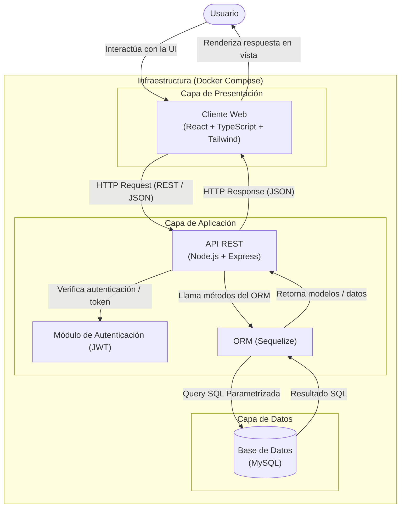
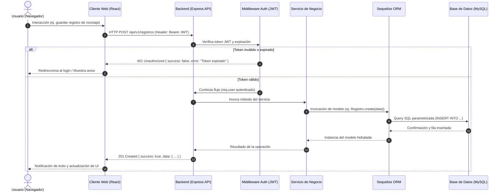
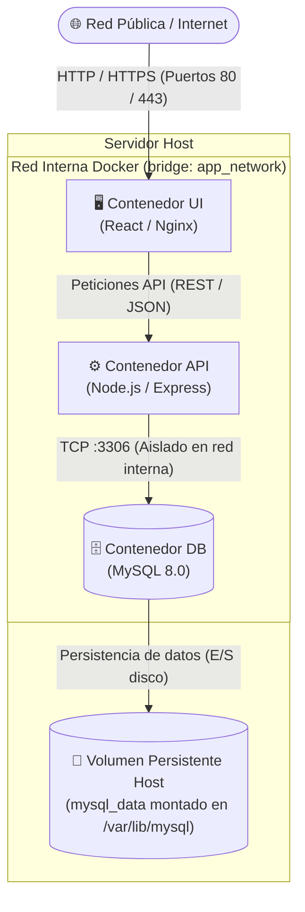

# Documento de Arquitectura de Software (SAD) — EcoCampus

Este documento describe la arquitectura de software del sistema, cubriendo los patrones de diseño, atributos de calidad, desglose modular por capas, diagramas estructurales y dinámicos, mecanismos de seguridad e infraestructura de despliegue.

---

## 1. Introducción, Propósito y Alcance

### 1.1. Propósito del Documento
Proporcionar una visión técnica integral de la arquitectura del sistema para desarrolladores, evaluadores y arquitectos, estableciendo directrices sobre la organización de componentes, flujos de datos, seguridad y persistencia.

### 1.2. Alcance del Sistema
La plataforma está diseñada para la gestión de sostenibilidad, reciclaje y cálculo de huella ecológica comunitaria. Requiere una interfaz de usuario fluida y reactiva en el cliente, respaldada por una API segura, escalable y transaccional que persista datos de usuarios, métricas de reciclaje y eventos ambientales.

---

## 2. Patrones Arquitectónicos y Principios de Diseño

El sistema implementa los siguientes patrones y principios:

1. **Arquitectura en Capas (Layered / N-Tier Architecture):** Separación estricta de responsabilidades entre la Capa de Presentación, la Capa de Aplicación (Lógica de Negocio) y la Capa de Datos (Persistencia).
2. **Cliente-Servidor Desacoplado (SPA + API RESTful Stateless):**
   - El cliente web funciona como una aplicación de página única (SPA) independiente.
   - El backend opera como una API REST sin estado (*Stateless*); cada petición incluye la información necesaria para su autenticación y procesamiento (tokens de sesión).
3. **Separación de Intereses (Separation of Concerns - SoC):** Desacoplamiento entre la lógica de interfaz de usuario, la validación de negocio, las reglas de acceso y el almacenamiento físico.
4. **Mapeo Objeto-Relacional (ORM):** Abstracción de la base de datos relacional para evitar acoplamiento directo a sentencias SQL crudas y prevenir vulnerabilidades de inyección de código.

---

## 3. Atributos de Calidad y Requerimientos No Funcionales (RNF)

| Atributo | Estrategia Arquitectónica |
| :--- | :--- |
| **Seguridad** | Autenticación mediante tokens JWT, cifrado de contraseñas con Bcrypt, sanitización de consultas vía ORM (Sequelize) y cabeceras de protección HTTP (CORS, Helmet). |
| **Rendimiento** | Empaquetado estático optimizado en frontend, consultas indexadas en MySQL y pool de conexiones gestionado por Sequelize. |
| **Escalabilidad** | Servicios desacoplados y contenedorizados en Docker; el backend puede escalar horizontalmente detrás de un balanceador de carga sin alterar la capa de datos. |
| **Mantenibilidad** | Código tipado estáticamente con TypeScript en el cliente, organización modular por capas en el servidor y control de cambios de base de datos mediante migraciones de Sequelize. |
| **Confiabilidad e Integridad** | Soporte de transacciones ACID en MySQL para operaciones críticas de persistencia. |

---

## 4. Ficha Técnica del Stack Tecnológico

| Capa / Subsistema | Tecnología | Versión / Tipo | Justificación Técnica |
| :--- | :--- | :--- | :--- |
| **Capa de Presentación** | React | `v19+` | Biblioteca declarativa para construcción de interfaces de usuario mediante componentes modulares. |
| **Lenguaje Frontend** | TypeScript | `v5+` | Tipado estático para reducir errores en tiempo de compilación y mejorar la mantenibilidad. |
| **Estilos & UI** | Tailwind CSS | `v4+` | Framework utilitario de alto rendimiento para diseño responsivo sin sobrecarga de CSS. |
| **Capa de Aplicación** | Node.js + Express | LTS | Entorno de ejecución asíncrono no bloqueante y framework minimalista para construcción de APIs REST. |
| **Capa ORM** | Sequelize | `v6+` | Abstracción de datos con soporte para migraciones, validaciones, transacciones y pool de conexiones. |
| **Capa de Datos** | MySQL | `8.0+` | Motor relacional robusto con soporte nativo de transacciones ACID e integridad referencial. |
| **Infraestructura** | Docker & Docker Compose | `v2+` | Contenedorización reproducible que aísla dependencias, redes internas y almacenamiento. |

---

## 5. Vista Estructural: Diagrama de Componentes

El siguiente diagrama modela la distribución lógica de componentes dentro de la infraestructura orquestada por Docker Compose:



---

## 6. Desglose Modular por Capas

### 6.1. Capa de Presentación (Frontend)
- **Vistas / Features:** Módulos de funcionalidad (Landing, Calculadora, Mapa de Reciclaje, Comunidad, Guía).
- **Componentes Reutilizables:** Layout global (Navbar, Footer, Modales, Toast de notificación).
- **Capa de Servicios API:** Módulo centralizado cliente HTTP (Axios / Fetch) configurado con interceptores para inyectar automáticamente el token `Authorization: Bearer <token>` y gestionar errores globales.

### 6.2. Capa de Aplicación (Backend Express)
El backend implementa un flujo unidireccional estructurado en 5 niveles:

```
Petición HTTP ➔ [Routes] ➔ [Middlewares] ➔ [Controllers] ➔ [Services] ➔ [Sequelize Models]
```

1. **Rutas (`routes/`):** Enrutadores de Express que mapean verbos y rutas HTTP (`/api/v1/...`) a controladores específicos.
2. **Middlewares (`middlewares/`):**
   - `authMiddleware`: Validación de firma y vigencia del JWT.
   - `validateSchema`: Validación del cuerpo de la petición (JSON) antes de llegar a la lógica.
   - `errorHandler`: Captura centralizada de excepciones para evitar fugas de información.
3. **Controladores (`controllers/`):** Reciben la petición (`req`), extraen parámetros y despachan la respuesta HTTP (`res`) con los códigos de estado apropiados.
4. **Servicios (`services/`):** Contienen las reglas de negocio puras, cálculos y lógica de dominio (independientes del framework HTTP).
5. **Modelos ORM (`models/`):** Definiciones de entidades en Sequelize con validaciones de campos, asociaciones (1:1, 1:N, N:M) y ganchos (*hooks*).

### 6.3. Capa de Datos (MySQL & Sequelize)
- **Migraciones:** Control de versiones del esquema relacional en archivos versionados en código (`migrations/`).
- **Semillas (*Seeders*):** Poblado automatizado de catálogos y datos iniciales para entornos de prueba y producción.
- **Transacciones:** Manejo de bloques transaccionales (`sequelize.transaction()`) en operaciones multi-tabla para garantizar atomicidad.

---

## 7. Vista Dinámica: Diagrama de Secuencia

El siguiente diagrama detalla la interacción temporal y el ciclo de vida de una petición autenticada:



---

## 8. Estrategia de Seguridad y Protección de Datos

1. **Autenticación y Manejo de Sesiones:**
   - Emisión de tokens **JWT** (JSON Web Tokens) firmados con secreto criptográfico seguro o par de claves asimétricas.
   - Hashing irreversible de contraseñas utilizando el algoritmo **Bcrypt** (con factor de costo de al menos 10 rondas de salt).
2. **Mitigación de Vulnerabilidades Comunes:**
   - **Inyección SQL:** Prevenida por el uso obligatorio de consultas parametrizadas a través de Sequelize.
   - **Cross-Origin Resource Sharing (CORS):** Lista blanca estricta configurada en Express permitiendo solicitudes únicamente desde el dominio del frontend.
   - **Cross-Site Scripting (XSS):** React escapa cadenas de texto por defecto en el DOM; sanitización estricta de payloads en el backend.
   - **Cabeceras Seguras:** Uso del middleware `helmet` en Express para configurar encabezados `Content-Security-Policy`, `X-Frame-Options`, `Strict-Transport-Security`, etc.
3. **Gestión de Variables de Entorno y Secretos:**
   - Separación estricta de credenciales mediante archivos `.env` (credenciales de MySQL, clave secreta JWT, puertos). Los archivos con secretos nunca se suben al repositorio.

---

## 9. Infraestructura y Configuración de Despliegue (Docker Compose)

La infraestructura local o de producción se define mediante servicios orquestados en Docker:



- **Aislamiento de Red:** Los contenedores se comunican a través de una red virtual tipo `bridge`. El puerto de MySQL (`3306`) **no se expone al exterior del host**, permitiendo conexiones únicamente desde el contenedor del Backend.
- **Persistencia con Volúmenes:** La carpeta de datos `/var/lib/mysql` se mapea a un volumen con nombre (`mysql_data`) para preservar la base de datos tras reinicios de contenedores.
- **Salud y Dependencias (`depends_on` con `healthcheck`):** El contenedor del backend espera a que el servicio de MySQL supere su comprobación de salud antes de iniciar el proceso del servidor.

---

## 10. Estandarización de Respuestas de API y Manejo de Errores

Para garantizar consistencia entre el Frontend y el Backend, todas las respuestas de la API adoptan una estructura JSON uniforme:

### Respuesta Exitosa (`200 OK`, `201 Created`)
```json
{
  "success": true,
  "data": {
    "id": 1,
    "titulo": "Punto de reciclaje Facultad de Telemática",
    "createdAt": "2026-10-22T13:00:00.000Z"
  },
  "meta": {
    "timestamp": "2026-10-22T13:00:00.000Z"
  }
}
```

### Respuesta de Error (`400 Bad Request`, `401 Unauthorized`, `500 Internal Error`)
```json
{
  "success": false,
  "error": {
    "code": "AUTH_TOKEN_EXPIRED",
    "message": "La sesión ha expirado. Por favor, inicie sesión nuevamente.",
    "details": []
  },
  "meta": {
    "timestamp": "2026-10-22T13:00:00.000Z"
  }
}
```
