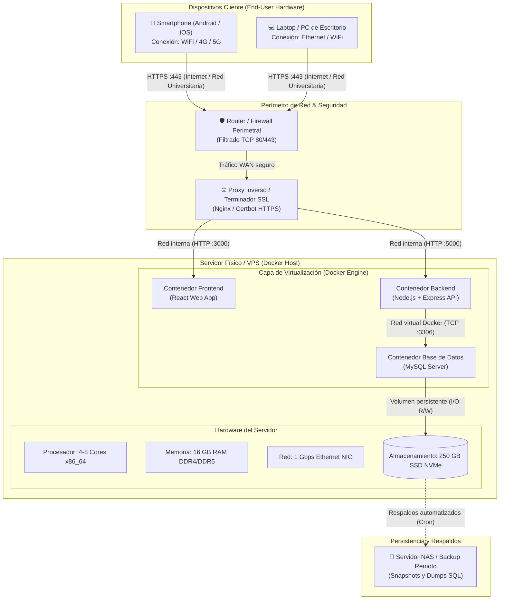

# Arquitectura de Hardware del Sistema

Este documento define la arquitectura de hardware (física y de despliegue) del sistema, especificando los equipos clientes, los dispositivos de red y seguridad perimetral, las características del servidor host (nodo de procesamiento), la virtualización mediante Docker y los mecanismos de persistencia y respaldo.

---

## 1. Visión General de la Infraestructura Física

El sistema opera bajo un modelo cliente-servidor distribuido sobre infraestructura web:

1. **Dispositivos Clientes:** Teléfonos inteligentes, computadoras portátiles y de escritorio que consumen la aplicación a través de navegadores web modernos mediante conexiones seguras (HTTPS).
2. **Perímetro de Red y Seguridad:** Enrutadores, cortafuegos institucionales y un proxy inverso que actúa como terminador SSL/TLS y distribuidor de tráfico local.
3. **Servidor Host de Aplicaciones:** Servidor físico o máquina virtual dedicada (VPS) con sistema operativo Linux, encargado de alojar y ejecutar el motor de Docker.
4. **Almacenamiento y Respaldos:** Discos de estado sólido de alta velocidad (SSD NVMe) para lectura/escritura de baja latencia en base de datos, respaldados periódicamente en almacenamiento secundario (NAS / Cloud Storage).

---

## 2. Diagrama de Arquitectura de Hardware

El siguiente diagrama representa la topología física, los dispositivos involucrados y los canales de comunicación:

---

## 3. Especificaciones Técnicas de los Componentes

### 3.1. Dispositivos Cliente
Los usuarios acceden a la plataforma sin necesidad de software propietario adicional, requiriendo únicamente un navegador web estándar:

| Parámetro | Requerimiento Mínimo | Requerimiento Recomendado |
| :--- | :--- | :--- |
| **Dispositivo** | Smartphone con Android 8.0+ / iOS 13+ | Smartphone moderno / Laptop / PC de escritorio |
| **Memoria RAM** | 2 GB | 4 GB o superior |
| **Navegador** | Google Chrome 90+, Safari 14+, Firefox 88+ | Versiones actualizadas (Evergreen browsers) |
| **Conectividad** | Conexión a Internet 3G / WiFi 2.4 GHz | WiFi 5 GHz / 4G LTE / 5G / Ethernet |

---

### 3.2. Servidor Host de Aplicaciones (Docker Host)

Nodo de cómputo donde se ejecutan los contenedores del sistema (Frontend, Backend y MySQL):

| Componente | Especificación Mínima (Desarrollo/Pruebas) | Especificación Recomendada (Producción) |
| :--- | :--- | :--- |
| **Arquitectura de CPU** | x86_64, 2 núcleos (2.0 GHz) | x86_64, 4 a 8 núcleos (ej. Intel Xeon / AMD EPYC) |
| **Memoria RAM** | 4 GB | 16 GB DDR4/DDR5 (Soporte ECC recomendado) |
| **Almacenamiento** | 60 GB SSD SATA | 250 GB SSD NVMe (I/O de alta concurrencia) |
| **Interfaz de Red (NIC)** | 100 Mbps Ethernet | 1 Gbps o 10 Gbps Full Duplex |
| **Sistema Operativo** | Ubuntu Server 22.04 LTS / Debian 11 | Ubuntu Server 24.04 LTS / Debian 12 |
| **Plataforma de Contenedores** | Docker Engine 24+ & Docker Compose v2 | Docker Engine 26+ & Docker Compose v2 |

---

### 3.3. Equipos de Red y Seguridad Perimetral

- **Firewall de Red:**
  - Solo permite tráfico entrante en los puertos estándar:
    - **TCP 80:** Redirección automática a HTTPS.
    - **TCP 443:** Tráfico cifrado HTTPS (TLS 1.2 / TLS 1.3).
    - **TCP 22:** SSH (restringido a IPs de administración o VPN interna).
- **Proxy Inverso / Terminador SSL:**
  - Instancia de Nginx en el host o contenedor frontal que gestiona los certificados SSL/TLS (ej. Let's Encrypt / Certbot).
  - Distribuye internamente las peticiones hacia el puerto del frontend (`:3000`) y el backend (`:5000`).

---

### 3.4. Persistencia, Almacenamiento y Respaldos

- **Persistencia de Base de Datos:**
  - El contenedor de MySQL no almacena datos volátiles en su capa temporal; utiliza un **Docker Volume** montado directamente en una partición del disco SSD NVMe del host (`/var/lib/docker/volumes/...` -> `/var/lib/mysql`).
- **Plan de Respaldos (Backups):**
  - Tarea programada vía `cron` en el host que ejecuta `mysqldump` de forma diaria o semanal.
  - Los archivos comprimidos generados se transfieren a un servidor NAS institucional o almacenamiento de objetos en la nube (S3 compatible) para garantizar tolerancia a fallos de hardware.
