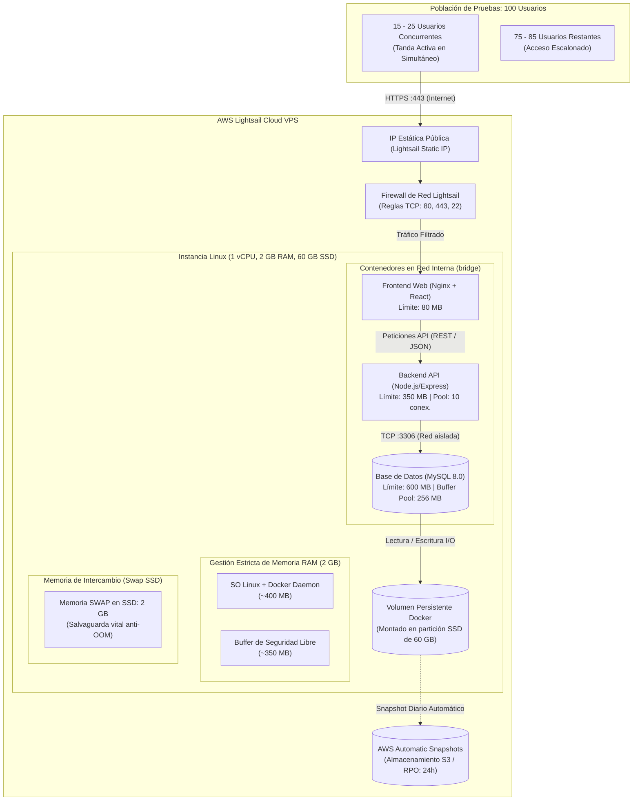
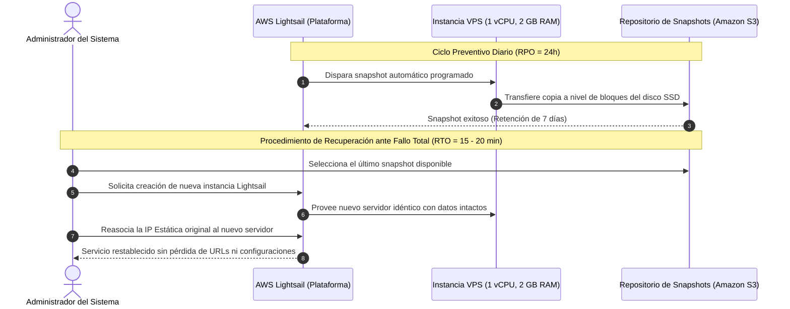

# Documento de Arquitectura de Hardware e Infraestructura (HAD) — EcoCampus

Este documento define la arquitectura de hardware, despliegue físico y topología de red para el sistema EcoCampus. Especifica las características de la infraestructura en **AWS Lightsail**, la asignación de recursos computacionales, el dimensionamiento de concurrencia para la fase de pruebas con 100 usuarios, los mecanismos de persistencia y las métricas de continuidad operativa (**RPO** y **RTO**).

---

## 1. Introducción, Propósito y Alcance del Despliegue

### 1.1. Propósito

Establecer las directrices de hardware, configuración de red, límites de memoria y resiliencia para el alojamiento en la nube del sistema, garantizando un entorno estable que no sufra caídas por falta de memoria (_Out of Memory - OOM_) durante las pruebas de campo.

### 1.2. Alcance y Entorno de Alojamiento

- **Proveedor Cloud:** Amazon Web Services (AWS) a través de **AWS Lightsail**.
- **Tipo de Servicio:** Servidor Virtual Privado (VPS) administrado en la nube.
- **Población Objetivo de la Fase de Pruebas:** Muestra de **100 usuarios** pertenecientes a la comunidad de la Universidad de Colima (estudiantes, profesores y personal administrativo).
- **Esquema de Uso:** Acceso web distribuido y escalonado durante la jornada de pruebas.

---

## 2. Topología de Infraestructura en AWS Lightsail

El siguiente diagrama modela la topología de red y los componentes de la instancia en AWS Lightsail:



---

## 3. Especificaciones del Servidor Host (AWS Lightsail)

La instancia seleccionada corresponde al bundle estándar de $10 USD/mes de AWS Lightsail:

| Componente                 | Especificación Técnica                                    | Rol en la Arquitectura                                                                      |
| :------------------------- | :-------------------------------------------------------- | :------------------------------------------------------------------------------------------ |
| **Procesador (vCPU)**      | 1 vCPU (Arquitectura x86_64, Intel Xeon / AMD EPYC)       | Procesamiento de peticiones HTTP, compilación de templates y ejecución del runtime Node.js. |
| **Memoria RAM**            | 2.0 GB (aprox. 1,950 MB útiles para el sistema operativo) | Asignada estrictamente entre SO, Docker, MySQL, Express y Nginx.                            |
| **Almacenamiento**         | 60 GB SSD de estado sólido (EBS integrado)                | Almacena el sistema operativo, imágenes Docker, volúmenes de MySQL y archivo swap.          |
| **Transferencia de Datos** | 3 TB de transferencia mensual incluida                    | Ancho de banda suficiente para soportar la fase de pruebas sin cargos por salida de datos.  |
| **Direccionamiento IP**    | 1 Dirección IPv4 Estática Pública asociada                | Garantiza que la IP pública no cambie ante reinicios o apagados del servidor.               |
| **Sistema Operativo**      | Ubuntu Server 24.04 LTS (64-bit)                          | Entorno base minimalista, seguro y con soporte a largo plazo.                               |

---

## 4. Gestión de Memoria y Dimensionamiento de Concurrencia

### 4.1. Distribución y Presupuesto de Memoria RAM

En servidores con 2 GB de RAM, la falta de control en el consumo de memoria puede provocar que el kernel ejecute el proceso _OOM Killer_ (Out Of Memory Killer), finalizando intempestivamente el contenedor de MySQL o Node.js. Para evitarlo, se definen los siguientes techos de memoria:

```
[ Sistema Operativo + Docker ] : ~400 MB
[ MySQL 8.0 (Buffer Pool 256M)]: ~500 - 600 MB
[ Node.js + Express API ]     : ~250 - 350 MB
[ Nginx (Archivos Estáticos) ] : ~40 - 60 MB
[ Buffer de Seguridad Libre ]  : ~350 - 450 MB
───────────────────────────────────────────────
TOTAL ASIGNADO ESTIMADO        : ~1,600 - 1,750 MB (Dentro de los 1.9 GB útiles)
```

### 4.2. Salvaguarda Vital: Memoria Swap de 2 GB en SSD

- Es obligatorio crear y habilitar un archivo swap de **2 GB** en la partición SSD del host (`/swapfile`).
- **Función:** Si un pico transitorio de concurrencia excede los 2 GB de RAM física, el kernel pagina páginas inactivas de memoria hacia el SSD en lugar de abortar abruptamente los procesos.

### 4.3. Cálculo de Concurrencia Segura para los 100 Usuarios

- **Población total evaluadora:** 100 usuarios.
- **Nivel de Concurrencia Máxima Segura:** **15 a 25 usuarios interactuando simultáneamente en el mismo segundo**.
- **Justificación Técnica:**
  - El frontend estático (React) se descarga una sola vez al navegador; a partir de ahí, la interacción genera peticiones asíncronas ligeras (REST JSON).
  - Un usuario activo realiza en promedio 1 petición cada 3 a 5 segundos (completando preguntas o consultando marcadores).
  - El backend cuenta con un **pool de 10 conexiones simultáneas a MySQL** administrado por Sequelize. Con una latencia por consulta de ~80 ms, el sistema es capaz de despachar entre 80 y 100 peticiones por segundo.
  - **Estrategia para la prueba:** Los 100 usuarios deben acceder de manera escalonada en tandas o dentro de un intervalo de prueba de 1 a 2 horas, asegurando que el grupo que haga clics al mismo instante no supere los 25 usuarios.

---

## 5. Requerimientos de los Dispositivos Cliente

Los 100 evaluadores participarán utilizando sus propios dispositivos personales (enfoque BYOD - _Bring Your Own Device_):

| Parámetro                | Requerimiento Mínimo                                | Requerimiento Recomendado                                   |
| :----------------------- | :-------------------------------------------------- | :---------------------------------------------------------- |
| **Dispositivos Móviles** | Android 8.0+ / iOS 13+                              | Android 11+ / iOS 15+                                       |
| **Computadoras**         | Laptops / PCs con Windows 10, macOS 11 o Linux      | Cualquier equipo de cómputo moderno                         |
| **Navegador Web**        | Google Chrome 95+, Safari 14+, Firefox 90+, Edge    | Versiones actualizadas (Chrome, Edge, Safari)               |
| **Conectividad**         | Conexión móvil 3G o WiFi básico de campus (2.4 GHz) | Conexión WiFi institucional 5 GHz o datos móviles 4G LTE/5G |

---

## 6. Perímetro de Red y Seguridad en AWS Lightsail

1. **Firewall de Red de Lightsail:**
   - La capa de red de AWS filtra el tráfico entrante a nivel perimetral antes de llegar a la máquina virtual:
     - **TCP 80 (HTTP):** Abierto para permitir validación de certificados y redirección a HTTPS.
     - **TCP 443 (HTTPS):** Abierto para todo el tráfico web cifrado de los usuarios.
     - **TCP 22 (SSH):** Restringido para acceso administrativo mediante llaves criptográficas SSH (RSA de 2048+ bits).
2. **Aislamiento del Puerto de Base de Datos:**
   - El puerto **TCP 3306 (MySQL) NO está expuesto** en el firewall de Lightsail ni en el host; solo es accesible internamente entre contenedores dentro de la red virtual `bridge` de Docker.
3. **Cifrado de Tráfico (SSL/TLS):**
   - Configuración de certificados TLS gratuitos y autorrenovables vía Let's Encrypt / Certbot gestionados en el contenedor de Nginx.

---

## 7. Persistencia de Datos y Mecanismo de Respaldos

- **Persistencia Local con Volúmenes Docker:**
  - El directorio de datos `/var/lib/mysql` se vincula a un volumen persistente de Docker almacenado en el SSD de 60 GB (`/var/lib/docker/volumes/...`).
- **AWS Lightsail Automatic Snapshots:**
  - AWS realiza una copia instantánea de seguridad (_snapshot_) automática diaria del disco SSD completo a una hora programada de bajo tráfico.
  - Los snapshots se almacenan en la infraestructura de **Amazon S3**, ofreciendo una durabilidad del 99.999999999% (11 nueves) y retención automática de las últimas 7 copias.

---

## 8. Métricas de Continuidad Operativa (RPO y RTO)

El plan de contingencia ante fallos define las siguientes métricas y procedimientos:

| Métrica                              | Definición                                      | Valor Asignado      | Justificación Operativa                                                                                                                                                                                    |
| :----------------------------------- | :---------------------------------------------- | :------------------ | :--------------------------------------------------------------------------------------------------------------------------------------------------------------------------------------------------------- |
| **RPO** _(Recovery Point Objective)_ | Máxima pérdida de datos tolerable en tiempo     | **24 Horas**        | Garantizado por la frecuencia de snapshot diario automático de AWS Lightsail. _(Para las pruebas de 100 usuarios, un script local puede generar dumps SQL cada 6 horas reduciendo el RPO a 6h sin costo)._ |
| **RTO** _(Recovery Time Objective)_  | Tiempo requerido para restablecer el servicio   | **15 - 20 minutos** | Tiempo estimado para desplegar una nueva instancia desde el último snapshot de AWS y reasignar la IP estática.                                                                                             |
| **RTO a nivel de Contenedor**        | Tiempo de autorecuperación por caída de proceso | **< 60 segundos**   | Directiva `restart: unless-stopped` en Docker Compose que levanta automáticamente cualquier contenedor si llega a fallar.                                                                                  |

### Diagrama del Ciclo de Continuidad y Recuperación



---

## 9. Monitoreo y Telemetría del Servidor

AWS Lightsail incluye métricas nativas y alarmas automáticas sin costo adicional:

1. **Métricas a Monitorear:**
   - **`CPUUtilization`:** Monitoreo del porcentaje de uso del procesador (alerta si supera el 85% sostenido durante más de 10 minutos).
   - **`StatusCheckFailed_Instance`:** Detección de fallos en el hardware físico subyacente de AWS.
   - **`StatusCheckFailed_System`:** Detección de problemas en la red o hipervisor de AWS.
   - **`NetworkIn` / `NetworkOut`:** Supervisión del volumen de datos transferidos para verificar la actividad de los usuarios.
2. **Notificaciones Automáticas:**
   - Activación de alertas por correo electrónico ante sobrecarga de CPU o caídas del servicio, permitiendo al equipo técnico intervenir oportunamente durante la jornada de pruebas.
