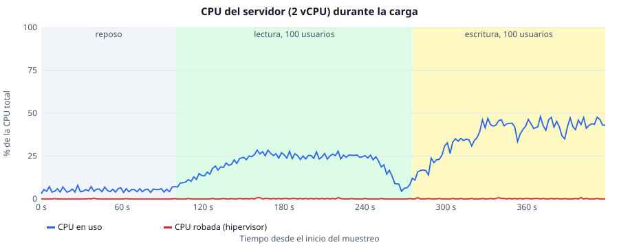
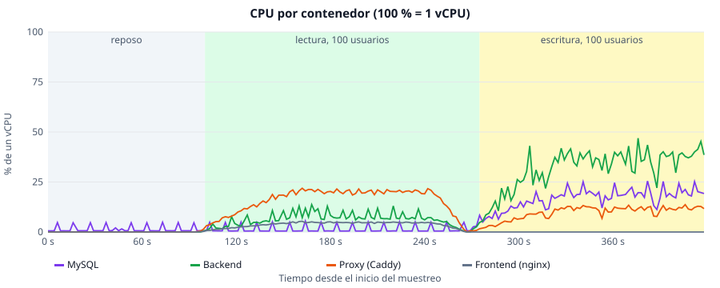
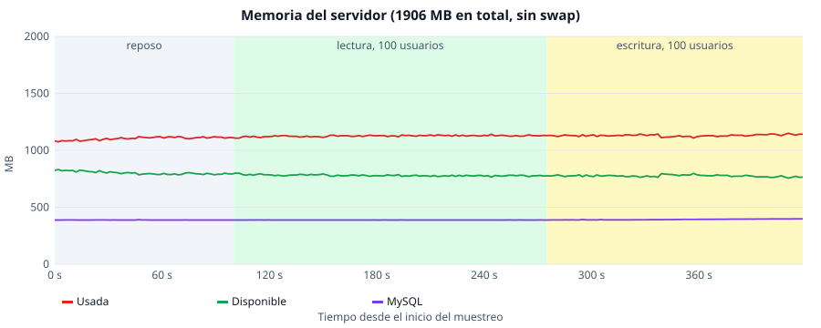

# Pruebas sobre el servidor de produccion (AWS Lightsail)

Reporte de las pruebas aplicadas al sitio desplegado en Lightsail, donde si hay una API propia, un servidor y una base de datos que medir. Sustituye a las pruebas "que no aplican" del esquema de GitHub Pages: ahora se mide la API, el servidor y la carga.

- URL probada: `http://3.143.203.113/ecocampus/` (HTTP; todavia no hay dominio ni HTTPS).
- Version desplegada: rama `experiment/survey-questions`, despues del PR #66 (acceso por correo y `LoginGate` restaurado).
- Modo de acceso del servidor: `correo` (`REQUIERE_LOGIN=false`).
- Fecha de las pruebas: 18 de octubre de 2026.
- Las mediciones se hicieron desde un equipo en Colima, Mexico, hacia Lightsail en `us-east-2` (Ohio). Los tiempos incluyen ese viaje de red: la latencia minima observada de cualquier peticion es de unos 60 ms y no es tiempo del servidor.

## Que se midio y donde esta

| Prueba | Herramienta | Resultado | Seccion |
| :--- | :--- | :--- | :--- |
| Rendimiento del cliente | Lighthouse 13.5.0 (3 corridas por pagina, movil y escritorio) | `resultados/lighthouse-resumen.md` y los JSON en `resultados/lighthouse/` | [Lighthouse](#rendimiento-del-cliente-lighthouse) |
| Rendimiento del cliente (segunda herramienta) | WebPageTest, inicio en escritorio y movil, 1 corrida cada uno | [webpagetest.md](./webpagetest.md) | [WebPageTest](#webpagetest) |
| Peticiones de red del navegador | Playwright (5 corridas en frio por pagina) | `resultados/red-resumen.md`, datos en `resultados/red.json` | [Red](#peticiones-de-red-del-navegador) |
| Compatibilidad en navegadores y dispositivos | Playwright (5 perfiles) | `resultados/compatibilidad.json` | [Compatibilidad](#compatibilidad) |
| Carga concurrente sobre el servidor (lectura y escritura) | k6 | `resultados/produccion-ligero.json`, `produccion-medio.json`, `produccion-escritura-ligero.json`, `produccion-escritura-medio.json` | [Carga](#carga-concurrente) |
| Endpoints de la API evaluados | k6 y Playwright | esta seccion | [Endpoints](#endpoints-evaluados) |
| Hardware, uso de recursos y logs del servidor | `recolectar-servidor.sh` (se ejecuta en el servidor) | `resultados/servidor.txt` | [Servidor](#servidor-hardware-logs-y-tiempos-del-backend) |
| CPU y memoria con 100 usuarios simultaneos | `muestrear-recursos.sh` (en el servidor) y `graficar-recursos.mjs` | `resultados/recursos.csv` y graficas SVG | [CPU y memoria](#cpu-y-memoria-durante-100-usuarios-simultaneos) |
| Georreferenciacion de los contenedores | `validar-georreferencia.mjs` | `resultados/georreferencia-validacion.md` | [Georreferenciacion](#georreferenciacion-de-los-contenedores) |

WebPageTest es un servicio externo: lo ejecuto la tesista desde su cuenta y aqui se documenta el resultado (ver [WebPageTest](#webpagetest)).

## Como repetirlas

Desde la raiz del repositorio (Docker y Node 22 instalados):

```bash
# Compatibilidad + registro de red (Playwright contra produccion; escribe en resultados/)
cd frontend
npx playwright test -c playwright.produccion.config.js
cd .. && node docs/testing/produccion/resumir-red.mjs > docs/testing/produccion/resultados/red-resumen.md

# Carga de lectura (solo GET; perfiles ligero, medio y alto). La de escritura es loadtest/k6-produccion-escritura.js
# (escribe filas y sesiones en produccion: borrarlas despues, ver su cabecera)
docker run --rm -v "$(pwd -W)/loadtest:/scripts" -e BASE=http://3.143.203.113 -e PERFIL=ligero \
  grafana/k6 run --summary-export=/scripts/results/produccion-ligero.json /scripts/k6-produccion.js

# Georreferenciacion
node docs/testing/produccion/validar-georreferencia.mjs

# Servidor (se ejecuta en el servidor, por SSH)
cd /opt/ecocampus && bash docs/testing/produccion/recolectar-servidor.sh > /tmp/servidor.txt
```

Lighthouse se ejecuto con `lighthouse@13.5.0` y Chrome 155 sin interfaz, perfil movil (emulacion y limitacion de red por defecto) y perfil de escritorio (`--preset=desktop`), tres corridas por pagina; la tabla muestra la mediana. El script `resumir-lighthouse.mjs` genera la tabla desde los JSON.

Las pruebas de compatibilidad y de lectura no envian el cuestionario: solo abren, como mucho, una sesion con el correo `prueba-playwright@ucol.mx`. Unicamente la prueba de escritura (k6) guarda filas.

## Rendimiento del cliente (Lighthouse)

Mediana de 3 corridas por combinacion. Detalle completo en `resultados/lighthouse-resumen.md`.

| Perfil | Pagina | Rendimiento | Accesibilidad | Buenas practicas | SEO | FCP (s) | LCP (s) | TBT (ms) | CLS | Peso (KB) | Peticiones |
| :--- | :--- | ---: | ---: | ---: | ---: | ---: | ---: | ---: | ---: | ---: | ---: |
| escritorio | inicio | 85 | 100 | 56 | 100 | 1.21 | 1.50 | 0 | 0.000 | 4118 | 29 |
| escritorio | calculadora | 87 | 94 | 78 | 100 | 1.20 | 1.38 | 0 | 0.016 | 491 | 19 |
| escritorio | mapa | 70 | 96 | 56 | 100 | 1.29 | 3.48 | 0 | 0.000 | 3122 | 38 |
| movil | inicio | 67 | 100 | 56 | 100 | 4.00 | 4.77 | 127 | 0.000 | 4118 | 29 |
| movil | calculadora | 60 | 98 | 78 | 100 | 3.48 | 5.07 | 0 | 0.176 | 491 | 19 |
| movil | mapa | 57 | 96 | 52 | 100 | 3.39 | 16.78 | 229 | 0.000 | 3050 | 32 |

Hallazgos (datos de los reportes de Lighthouse):

- **Peso de las imagenes.** Inicio transfiere unos 4 MB y el mapa unos 3 MB; Lighthouse estima ahorros de hasta 3.5 MB en entrega de imagenes. En la pagina de inicio, WebPageTest muestra que el peso son dos fotos externas de Pexels y Unsplash descargadas a 3000 px o mas (2.3 MB y 0.95 MB) para mostrarse a unos 222 px en escritorio; en movil no se descargan y la pagina pesa 531 KB (ver [webpagetest.md](./webpagetest.md)). Las fotografias de los contenedores del mapa pesan alrededor de 1.5 MB cada una. Es la causa principal del LCP de 16.8 s en el mapa en movil.
- **Sin HTTPS.** "Buenas practicas" baja (52 a 78) por 15 a 17 peticiones inseguras y por no redirigir HTTP a HTTPS. Se resuelve con un dominio y `SITE_ADDRESS` en Caddy (ver README, seccion Produccion).
- **Cache.** Los archivos de `/assets/` ya se sirven con `Cache-Control: public, immutable` por un ano (lo confirma WebPageTest); lo que no lleva cache son las imagenes propias (logos, favicon, fotos) y el manifest, y de ahi los 170 a 250 KB de ahorro que marca Lighthouse.
- **Redireccion.** Lighthouse detecta una redireccion en la carga que cuesta unos 1.1 s en movil (no se identifico cual; probablemente la de `/ecocampus` a `/ecocampus/`).
- **Cookies de terceros.** Lighthouse detecta 2 o 3 en las paginas (no se identifico su origen).
- Accesibilidad y SEO son altas (94 a 100 y 100).
- Desplazamiento de diseno (CLS) de 0.176 en la calculadora en movil, por encima del umbral recomendado de 0.1.

### WebPageTest

Una corrida de la pagina de inicio por perfil (Chrome 152; escritorio 1024x681 y movil 393x659; solo primera visita). Detalle y conclusiones en [webpagetest.md](./webpagetest.md).

| Metrica | Escritorio | Movil |
| :--- | ---: | ---: |
| TTFB | 37 ms | 143 ms |
| FCP | 858 ms | 1103 ms |
| LCP | 1055 ms | 1300 ms |
| Speed Index | 1384 ms | 1688 ms |
| TBT | 0 ms | 0 ms |
| CLS | 0 | 0 |
| Carga completa | 1423 ms | 1270 ms |
| Peticiones | 26 | 23 |
| Bytes recibidos | 4.27 MB | 0.54 MB |

Los Core Web Vitals quedan en rango bueno en ambos perfiles. En escritorio el peso (3.94 MB de imagenes) viene de dos fotos externas de Pexels y Unsplash que se muestran a unos 222 px; en movil esas fotos no se descargan durante la carga. Las cifras de movil son mejores que las de Lighthouse porque WebPageTest no aplico su limitacion de CPU y de red. Quedan pendientes las 3 corridas y las paginas de calculadora y mapa.

## Peticiones de red del navegador

Playwright (Chromium 153), 5 cargas en frio por pagina, sin cache. Resumen completo en `resultados/red-resumen.md`.

| Pagina | Peticiones | Propias | Externas | Fallidas | HTTP 4xx/5xx | Transferido (KB) |
| :--- | ---: | ---: | ---: | ---: | ---: | ---: |
| `/ecocampus/` | 25 | 15 | 10 | 2 | 0 | 4099 |
| `/ecocampus/calculadora` | 15 | 11 | 4 | 0 | 0 | 473 |
| `/ecocampus/mapa` | 33 | 13 | 20 | 0 | 0 | 3104 |
| `/ecocampus/comunidad` | 19 | 14 | 5 | 0 | 0 | 749 |
| `/ecocampus/guia-reciclaje` | 21 | 16 | 5 | 0 | 0 | 1532 |

Por origen: las 345 peticiones al servidor propio tienen media de 158 ms y p95 de 286 ms, sin fallos. Las 220 externas (OpenStreetMap, fuentes y el sitio de la universidad) tienen media de 230 ms y p95 de 1038 ms. Los 75 mosaicos de OpenStreetMap tuvieron media de 281 ms y ninguno fallo.

Porcentaje de fallos: 10 de 565 peticiones (1.8 %), todas la misma imagen externa: `https://www.ucol.mx/content/portal/banner_733551615849.jpg` en la pagina de inicio, bloqueada por el navegador (`net::ERR_BLOCKED_BY_ORB`) en las 5 corridas (se pide dos veces por carga). El servidor de la universidad no la entrega como imagen a un sitio ajeno; conviene copiar esa imagen al proyecto o quitarla. No hay ningun fallo en recursos propios.

## Compatibilidad

Playwright 1.63, mismas pruebas de las vistas publicas que `frontend/e2e/compatibilidad.spec.js`, ahora contra el servidor. Resultado: **41 de 41 correctas** (40 de compatibilidad y 1 de registro de red), 2 min 53 s.

| Proyecto | Motor y version | Sistema (agente de usuario) | Ventana | Tactil |
| :--- | :--- | :--- | :--- | :--- |
| `chromium` | Chromium 153.0.8010.12 | Windows 10/11 (maquina real: Windows 11) | 1280x720 | No |
| `firefox` | Firefox 155.0 | Windows 10/11 (maquina real: Windows 11) | 1280x720 | No |
| `webkit` | WebKit 26.6 (motor de Safari) | macOS 10.15.7 (emulado) | 1280x720 | No |
| `movil-android-chrome` | Chromium 153.0.8010.12, perfil Pixel 7 | Android 14 (emulado) | 412x839 | Si |
| `movil-ios-safari` | WebKit 26.6, perfil iPhone 14 | iOS 16.0 (emulado) | 390x664 | Emulado |

Cada perfil comprueba: inicio, acceso por correo (rechaza `@gmail.com` y pide correo `@ucol.mx`), calculadora tras entrar (pregunta 1 y avance a la 2), mapa (21 marcadores, mosaicos y popup), comunidad, guia de reciclaje, ausencia de desbordamiento horizontal y la API (`/api/me` responde el modo de acceso y `POST /api/respuestas` sin sesion devuelve 401).

Limitaciones: los perfiles de Safari y de movil son emulados en un equipo Windows; no se probaron dispositivos fisicos ni Edge. Una prueba en un iPhone o Mac real queda pendiente si se necesita cubrir Safari de verdad.

Durante esta ejecucion se detecto que el titulo del mapa cambio a "Mapa de Reciclaje" tras el rediseno y las pruebas de `e2e/compatibilidad.spec.js` seguian esperando el anterior; se actualizaron ambas.

## Carga concurrente

k6 desde el equipo de la tesista (no comparte maquina con la VM), `loadtest/k6-produccion.js`, **solo lecturas** (`GET`) para no gastar la cuota de transferencia. No pide las fotos de los contenedores. Cada usuario virtual repite: inicio, calculadora, mapa, JS, CSS y `/api/me`, con 1 s de pausa.

| Perfil | Usuarios virtuales (maximo) | Duracion | Peticiones | Por segundo | Fallos | Media (ms) | p95 (ms) | p99 (ms) | Maximo (ms) | Datos recibidos |
| :--- | ---: | ---: | ---: | ---: | ---: | ---: | ---: | ---: | ---: | ---: |
| ligero | 10 | 1 min 20 s | 1741 | 21.5 | 0.00 % | 89 | 205 | 222 | 334 | 23 MB |
| medio | 30 | 1 min 50 s | 7363 | 66.7 | 0.00 % | 87 | 197 | 210 | 845 | 97 MB |
| cien | 100 | 2 min 50 s | 51 499 | 300.6 | 0.00 % | 87 | 195 | 203 | 638 | 680 MB |

Mediana por endpoint en el perfil medio: inicio 64 ms, calculadora 64 ms, mapa 64 ms, CSS 68 ms, `/api/me` 65 ms y el JS principal 192 ms (el unico mayor porque pesa mas). El p95 de todos queda por debajo de 215 ms y todos los umbrales de k6 se cumplieron (fallos por debajo de 1 %, p95 por debajo de 1.5 s).

Con 3 veces mas usuarios el tiempo de respuesta no aumento: el servidor no llego a su limite en estos perfiles.

### Escritura (`POST /api/respuestas`)

Con autorizacion de la tesista, que borrara los datos despues, se midio la escritura sobre produccion: `loadtest/k6-produccion-escritura.js`. Cada iteracion abre una sesion con un correo unico (`k6-carga-<usuario>-<iteracion>-<marca>@ucol.mx`, con `POST /api/acceso/correo`) y envia un cuestionario valido, con 1 s de pausa. Escribe una fila en `respuestas` y una sesion en `sessions` por iteracion.

| Perfil | Usuarios virtuales (maximo) | Duracion | Respuestas guardadas | Peticiones por segundo | Fallos | Acceso por correo: media / p95 / max (ms) | Envio: media / p95 / max (ms) |
| :--- | ---: | ---: | ---: | ---: | ---: | :--- | :--- |
| ligero | 10 | 1 min 20 s | 366 | 9.1 | 0.00 % | 115 / 153 / 201 | 98 / 117 / 140 |
| medio | 30 | 1 min 50 s | 1611 | 29.2 | 0.00 % | 80 / 125 / 230 | 79 / 102 / 183 |
| cien | 100 | 2 min 50 s | 10 989 | 128.8 peticiones (64.4 respuestas) | 0.00 % | 93 media; p95 212 / p99 331 / max 479 | 79 mediana; p95 193 / p99 216 / max 236 |

- Todas las respuestas se guardaron (codigo 201) y todos los accesos dieron 200; no hubo 4xx, 5xx ni duplicados. Los umbrales de k6 (fallos por debajo de 1 %, p95 por debajo de 1.5 s) se cumplieron.
- Se escribieron 1977 filas en total (366 + 1611). Cada envio completo (acceso mas guardado) tarda alrededor de 200 ms en el cliente, incluidos ~65 ms de red por peticion.
- El ritmo maximo probado fue de unos 14.6 respuestas guardadas por segundo con 30 usuarios; un estudio real tendra muchisimo menos simultaneidad.
- Los filtros de limpieza estan al inicio del script: `DELETE FROM respuestas WHERE correo LIKE 'k6-carga-%';` y `DELETE FROM sessions;` (la segunda tambien cierra las sesiones de cualquier persona conectada en ese momento).
- Con 100 usuarios (perfil `cien`, 17:33 a 17:40 UTC) se guardaron 10 989 respuestas mas, todas con codigo 201, sin fallos y sin que los tiempos crecieran; el consumo de CPU y memoria del servidor en esa prueba esta en [CPU y memoria durante 100 usuarios simultaneos](#cpu-y-memoria-durante-100-usuarios-simultaneos). No se probo un perfil mayor.

## Endpoints evaluados

La API de produccion se expone solo a traves del proxy; `/health` y `/docs` no son publicos (devuelven 404, es intencional).

| Endpoint | Metodo | Se evaluo con | Resultado |
| :--- | :--- | :--- | :--- |
| `/api/me` | GET | k6 (carga) y Playwright | 200 en todas las peticiones; media 65 ms |
| `/api/acceso/correo` | POST | Playwright y k6 (escritura) | 403 con dominio ajeno; 200 con `@ucol.mx` en las 1977 iteraciones de carga |
| `/api/respuestas` | POST | Playwright (sin sesion) y k6 (escritura) | 401 sin sesion; 201 en las 1977 escrituras de carga |
| `/ecocampus/`, `/calculadora`, `/mapa` | GET | k6 y Lighthouse | 200; media 64 ms |
| Archivos JS y CSS | GET | k6 | 200; JS 192 ms, CSS 68 ms |

Numero de peticiones de las pruebas de carga: lectura 1741 (ligero) y 7363 (medio); escritura 732 (ligero) y 3222 (medio). Todas con el codigo esperado.

## Servidor: hardware, logs y tiempos del backend

Datos tomados en el servidor con `recolectar-servidor.sh` el 18 de octubre de 2026, 07:21 UTC (salida completa en `resultados/servidor.txt`). El script solo lee y no imprime secretos.

| Recurso | Valor |
| :--- | :--- |
| Sistema operativo | Ubuntu 24.04.4 LTS (kernel 7.0.0-1012-aws) |
| CPU | 2 vCPU, Intel Xeon Platinum 8259CL a 2.5 GHz |
| Memoria | 1906 MB en total, sin swap; 845 MB disponibles en reposo |
| Disco | 58 GB, 11 % usado (6.2 GB) |
| Docker | 29.9.1; Compose v5.6.0 |
| Region | AWS Lightsail `us-east-2` |

Uso en reposo (instantaneo, sin carga):

| Contenedor | CPU | Memoria | Limite | Reinicios |
| :--- | ---: | ---: | ---: | ---: |
| `db` (MySQL 8.0) | 0.61 % | 375 MiB | 1 GiB | 0 |
| `backend` | 0.01 % | 42.8 MiB | 512 MiB | 0 |
| `proxy` (Caddy) | 0.00 % | 20.4 MiB | 128 MiB | 0 |
| `frontend` (nginx) | 0.00 % | 4.0 MiB | 128 MiB | 0 |

La carga promedio del sistema es 0.04 y todos los contenedores estan sanos y sin reinicios. MySQL es el mayor consumidor; con la memoria total de 1.9 GB y sin swap queda margen (845 MB), pero no mucho si se agregan servicios.

Distribucion de tiempos de respuesta del backend (log de las ultimas 24 h, que incluye las pruebas de carga de este reporte y las pruebas manuales; son tiempos de procesamiento del servidor, sin el viaje de red):

| Endpoint | Peticiones | 2xx/3xx | 4xx | 5xx | Media (ms) | p50 | p95 | p99 | Maximo |
| :--- | ---: | ---: | ---: | ---: | ---: | ---: | ---: | ---: | ---: |
| `GET /api/me` | 1597 | 1597 | 0 | 0 | 1 | 1 | 1 | 2 | 24 |
| `GET /health` | 467 | 467 | 0 | 0 | 2 | 2 | 4 | 7 | 49 |
| `POST /api/acceso/correo` | 27 | 16 | 11 | 0 | 9 | 9 | 29 | 48 | 48 |
| `POST /api/respuestas` | 12 | 1 | 11 | 0 | 3 | 1 | 28 | 28 | 28 |

- No hubo ningun error 5xx. Los 4xx son esperados: dominios ajenos rechazados en las pruebas (403) y envios sin sesion (401).
- El backend atiende en 1 a 2 ms las lecturas: durante la carga de 30 usuarios virtuales (66.7 peticiones por segundo en total) no fue el cuello de botella; los ~65 ms medidos desde el cliente son casi todos de red.
- Los tiempos de `POST /api/acceso/correo` (hasta 48 ms) incluyen crear la sesion en MySQL.
- La base tiene 1 respuesta (la de prueba del despliegue, del 18 de octubre a las 06:04, con acceso por correo, que debe borrarse antes de abrir el estudio) y 16 sesiones activas (de las pruebas de compatibilidad y manuales).
- Limitacion: el log del backend solo guarda el tiempo del servidor y el estado; no hay logs de acceso del proxy con tiempos (Caddy registro 48 lineas, sin detalle por peticion). Tampoco se midio el trafico de red del servidor.

### CPU y memoria durante 100 usuarios simultaneos

Se muestreo el servidor cada ~3 s (`muestrear-recursos.sh`, datos en `resultados/recursos.csv`, 209 muestras) mientras se aplicaban, una tras otra, la carga de lectura y la de escritura con 100 usuarios virtuales. El muestreo no guarda la hora; las fases se identifican por el patron de CPU: reposo hasta ~100 s, lectura de ~100 s a ~275 s y escritura desde ~275 s. El muestreo termino a los 420 s y no incluye los ultimos ~30 s de la escritura (la bajada de usuarios).

| Fase | CPU del servidor, media / maxima | CPU robada | MySQL | Backend | Proxy | Memoria usada (max.) | Memoria disponible (min.) |
| :--- | ---: | ---: | ---: | ---: | ---: | ---: | ---: |
| Reposo | 5.2 % / 8.0 % | 0.0 % | 1.4 % | 0.0 % | 0.0 % | 1122 MB | 785 MB |
| Lectura, 100 usuarios | 20.7 % / 28.5 % | 0.1 % (max. 0.8 %) | 1.4 % | 6.4 % | 15.6 % | 1141 MB | 765 MB |
| Escritura, 100 usuarios | 37.5 % / 48.1 % | 0.1 % (max. 0.8 %) | 16.9 % (max. 25.5 %) | 32.1 % (max. 46.9 %) | 9.8 % | 1150 MB | 756 MB |

La CPU del servidor es el porcentaje de los 2 vCPU; la de cada contenedor es porcentaje de un vCPU (100 % = un vCPU completo), medias de la fase.







- **El servidor no se saturo.** El maximo de CPU fue 48.1 % de los 2 vCPU, con 100 usuarios escribiendo, y 28.5 % con 100 usuarios leyendo; queda mas de la mitad de la capacidad libre.
- **Sin estrangulamiento de CPU.** La CPU robada por el hipervisor se mantuvo en 0.8 % o menos durante toda la prueba: no se agoto la capacidad de rafaga de Lightsail en estos 6 minutos. Una carga sostenida durante horas podria comportarse distinto.
- **La lectura la lleva el proxy; la escritura, el backend y MySQL.** En lectura el contenedor mas activo es Caddy (15.6 % de un vCPU) por servir los archivos; en escritura el backend llega a 46.9 % y MySQL a 25.5 % de un vCPU.
- **La memoria no crece.** El uso total subio de unos 1104 MB en reposo a un maximo de 1150 MB (46 MB mas) y siempre quedaron al menos 756 MB disponibles; sin swap y sin presion de memoria. MySQL pasa de 388 MB a 399 MB y el backend de 50 MB a 57 MB.
- **Carga del sistema.** El promedio de carga a 1 minuto llego a 3.03 con 2 vCPU, por encima de 2 aunque la CPU estaba al 48 %: hay procesos esperando (muy probablemente escrituras a disco de MySQL, que no se midieron aparte). Los tiempos de respuesta no se vieron afectados: la escritura con 100 usuarios tuvo p95 de 200 ms.
- **Margen.** Con las cifras actuales, el estudio (muchisimo menos simultaneidad que 100 usuarios escribiendo a 64 respuestas por segundo) tiene un margen amplio de capacidad en este servidor.

## Georreferenciacion de los contenedores

Los 21 contenedores estan en `frontend/src/features/mapa/puntosReciclaje.js` como pares `[latitud, longitud]` en WGS84 y se dibujan sobre mosaicos de OpenStreetMap (Leaflet, centro `[19.249437, -103.698893]`, zoom 17).

Validacion automatica (`validar-georreferencia.mjs`, tabla completa en `resultados/georreferencia-validacion.md`):

- 21 puntos, todos con latitud y longitud validas y con fotografia en `frontend/public/Depositos/`.
- Caja envolvente de 463 m (este-oeste) por 356 m (norte-sur): consistente con el tamano del Campus Central.
- Todos a 306 m o menos del centro del mapa.
- Distancia minima entre dos puntos: 13.9 m; ningun punto duplicado (menos de 1 m de otro).
- La precision de los decimales (hasta 15) excede la del GPS de un telefono (unos 3 a 5 m); no implica esa exactitud en campo.

**Origen de los datos:** las coordenadas las tomo el primer equipo que desarrollo este proyecto (informacion de la tesista, 18 de octubre de 2026). Ese equipo no dejo registrado en el repositorio como las obtuvo (en sitio con un telefono o desde un mapa en linea), ni la fecha ni el margen de error; por eso no se afirma un metodo. Los decimales largos de la mayoria de los puntos sugieren que se copiaron de un visor de mapas, pero es una inferencia. Para cerrar el procedimiento que pide la revision hay dos caminos: preguntar al primer equipo como las tomaron, o repetir la captura (en sitio, con el GPS de un telefono, anotando fecha, dispositivo y precision que reporta) en una muestra de puntos y comparar contra las coordenadas actuales con `validar-georreferencia.mjs`.

## Hallazgos y acciones recomendadas

| Prioridad | Hallazgo | Accion |
| :--- | :--- | :--- |
| Alta | Inicio pesa 4 MB en escritorio por dos fotos externas (Pexels y Unsplash) descargadas a 3000 px para mostrarse a 222 px; las fotos de 1.5 MB del mapa; el mapa en movil tiene LCP de 16.8 s | Pedir las fotos externas ya redimensionadas o servirlas desde el proyecto en WebP a unos 600 px; comprimir las fotos del mapa (WebP, ancho maximo de 800 px) |
| Alta | Sin HTTPS | Dominio y HTTPS con Caddy; mejora "buenas practicas" y es requisito del login federado |
| Media | Imagenes propias (logos, favicon, fotos) y manifest sin `Cache-Control`; `/assets/` ya esta bien | Cache larga tambien para `/Logos/`, `/Depositos/` y el favicon |
| Media | Imagen de `ucol.mx` bloqueada en inicio (10 de 565 peticiones) | Copiarla al proyecto o quitarla |
| Media | Una redireccion de unos 1.1 s en movil | Identificar cual es (probablemente `/ecocampus` a `/ecocampus/`) y evitarla |
| Baja | CLS de 0.176 en la calculadora en movil | Reservar el tamano de la imagen de cada pregunta |
| Media | Servidor de 1.9 GB de RAM sin swap; MySQL usa 375 MiB en reposo | Vigilar la memoria durante el estudio; subir de plan o agregar swap si hay picos |
| Baja | Procedimiento de georreferenciacion sin confirmar | Completar la seccion con quien capturo las coordenadas |

## Archivos de esta carpeta

| Archivo | Para que sirve |
| :--- | :--- |
| `README.md` | Este reporte |
| `resumir-lighthouse.mjs` | Convierte los JSON de Lighthouse en la tabla de resumen |
| `resumir-red.mjs` | Convierte `red.json` en tablas de peticiones, tiempos y fallos |
| `validar-georreferencia.mjs` | Valida las coordenadas de los contenedores |
| `recolectar-servidor.sh` | Recolecta hardware, recursos y logs en el servidor |
| `muestrear-recursos.sh` | Registra CPU y memoria cada ~3 s en un CSV mientras se aplica carga (se ejecuta en el servidor) |
| `graficar-recursos.mjs` | Dibuja las graficas SVG de CPU y memoria a partir de `resultados/recursos.csv` |
| `resultados/` | Datos crudos y resumenes de cada prueba |

El codigo de las pruebas vive fuera de esta carpeta: `frontend/playwright.produccion.config.js`, `frontend/e2e-produccion/` y `loadtest/k6-produccion.js`.
